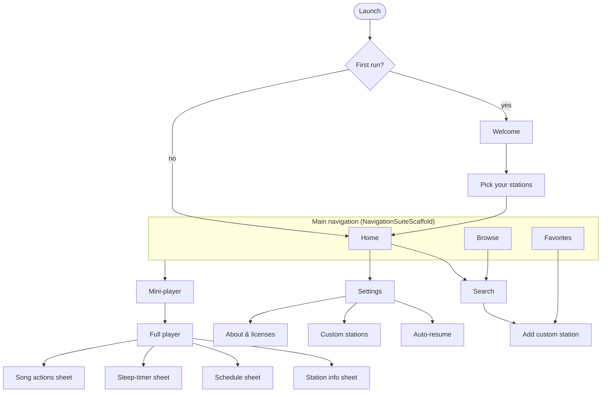

# SPEC-02 · UX & Visual Design — Material 3 Expressive

| | |
|---|---|
| **Status** | Draft v0.1 — for review |
| **Date** | 2026-10-26 |
| **Related** | [Overview](SPEC.md) · [01 Product](SPEC-01-product.md) · [03 Architecture](SPEC-03-architecture.md) · [04 Catalog](SPEC-04-catalog.md) |

Design decisions taken with the maintainer: **M3 Expressive** · **dynamic color** with a brand fallback (seed `#6750A4`) and a settings toggle · **pure-black (AMOLED)** option · **adaptive** phone/tablet/foldable layouts · navigation **Home · Browse · Favorites** with a search bar on top · **player tinted from the station logo**.

---

## 1. Design principles

1. **One tap to audio.** Every station surface plays on tap. Nothing stands between the user and sound.
2. **Logos are the hero.** Station artwork carries recognition, so text stays secondary.
3. **Expressive where it matters, calm elsewhere.** Springy motion and shape morphing are reserved for meaningful moments: play/pause, buffering, favoriting, and opening the player.
4. **Hebrew-first and bidi-correct.** RTL is a primary layout, not a port.
5. **Accessible by default.** Large text, TalkBack, and reduced motion are designed in, not bolted on.
6. **Feels like Android.** Prefer standard M3 components and system integrations over custom inventions.

## 2. Design system

### 2.1 Theme entry point

- A single `ShidurTheme` composable wraps `MaterialExpressiveTheme(colorScheme, motionScheme = MotionScheme.expressive(), shapes, typography)`.
- Expressive components come from Compose Material 3 1.5.x (1.5.0-beta02 on 2026-10-26). The Expressive APIs are **still `@ExperimentalMaterial3ExpressiveApi`** ([SPEC-03 §2](SPEC-03-architecture.md#2-technology-stack)). All Expressive usage is wrapped in `:core:designsystem`, so API churn touches one module.

### 2.2 Color

Scheme selection, in priority order:

| Context | Source |
|---|---|
| Full player | **Station scheme** derived from the logo ([§2.3](#23-station-tinted-player)), when the setting is on |
| Everywhere else (default) | **Dynamic color** — `dynamicLight/DarkColorScheme(context)`. Available on every supported device, since minSdk 31 = Android 12 |
| Dynamic color off, or the user prefers brand | **Brand scheme** generated from seed **`#6750A4`** with the *Tonal Spot* variant (matches the M3 baseline palette), light and dark |

- **Theme mode:** System / Light / Dark.
- **Pure black:** a toggle that applies in dark mode. `background` and `surface` become `#000000`; `surfaceContainerLowest…Highest` map to near-black neutral tones (≈ T2–T10) so container hierarchy stays visible; accents are unchanged.
- **Contrast:** brand and station schemes are generated with the user's Android 14+ contrast level (`UiModeManager.getContrast()` → MCU `contrastLevel` 0 / 0.5 / 1.0). Dynamic schemes come from the system.
- **Semantic extras:** `live` (the red "● LIVE" dot) is harmonized toward `primary` with MCU `Blend.harmonize`. Monogram tiles for stations without logos get a deterministic hue from the station ID, also harmonized.

### 2.3 Station-tinted player

- The seed comes from the station logo: decode the bitmap (Coil), quantize (MCU `QuantizerCelebi`), and score (`Score`). Build a `SchemeContent` (content-fidelity variant) in the current light/dark mode and contrast level.
- Computed off the main thread and cached per `(stationId, logoHash, mode)`.
- Low-chroma logos (black/white wordmarks are common) fall back to the app scheme.
- Applied to the **full player** and the **expanded-width player pane**. The mini-player keeps the app scheme for visual stability.
- Station switches animate the color change (effects spring, ~400 ms).
- With pure black on, the background stays `#000000` and only containers and accents are tinted.
- Contrast stays correct because roles come from MCU tones, never raw extracted pixels.

### 2.4 Typography

- **Font:** [Heebo](https://fonts.google.com/specimen/Heebo), a variable font under SIL OFL 1.1 covering Hebrew and Latin. Its Latin glyphs derive from Roboto, so it looks native on Android. It is **bundled** in `res/font` rather than downloaded, so it works without Google Play services.
- **Type scale:** the standard M3 scale, plus Expressive *emphasized* styles for:
  - the player station name (`headlineMediumEmphasized`);
  - section headers (`titleLargeEmphasized`);
  - now-playing title (`titleMediumEmphasized`).
- **Numerals:** tabular figures (`fontFeatureSettings = "tnum"`) for frequencies, times, and countdowns.
- **Arabic names** (Makan, A-Shams) fall back to the system Noto Sans Arabic. Row heights must be verified so tall Arabic glyphs aren't clipped.

### 2.5 Shape

- The M3 shape scale, including Expressive steps: extra-small 4 · small 8 · medium 12 · large 16 · large-increased 20 · extra-large 28 · extra-large-increased 32 · extra-extra-large 48 dp.
- **Station artwork:**
  - rows: rounded square, *medium*;
  - tiles: *extra-large*;
  - full player: a `MaterialShapes` polygon that **morphs** from a rounded square (paused) to *Cookie 9-sided* (playing), with a slow 20 s rotation while playing.
- **Play/pause:** an Expressive toggle button with a shape morph (round ↔ squircle) on press and state change.
- Morph loops and rotation are disabled when the system *Remove animations* setting is on.

### 2.6 Motion

- `MotionScheme.expressive()` throughout: **spatial** springs (slight overshoot) for position, size, and containers; **effects** springs (no overshoot) for color and opacity.

| Moment | Treatment |
|---|---|
| Tile/row → full player | Shared-element transition (logo + name) with `SharedTransitionLayout` |
| Mini-player ↔ full player | Container transform; drag-to-expand follows the finger |
| Back from full player | **Predictive back**: the player scales/translates with the gesture before committing |
| Buffering | `LoadingIndicator` (morphing polygons) inside the play button |
| Favorite toggle | Heart fill + spring "pop" + light haptic |
| List entry | Fade + slight slide, staggered for the first ≤ 6 items |
| Station switch (swipe) | Pager motion between artworks; scheme crossfade |

- **Reduced motion:** when the animator duration scale is 0, loops, morphs, and staggers are replaced by simple fades.

### 2.7 Iconography

- **Material Symbols Rounded** (Apache-2.0), imported as vector drawables for the glyphs actually used. Outline is the default; filled marks selected navigation items and active toggles. The unmaintained `material-icons-extended` artifact is **not** used.
- **Bidi:** directional navigation icons (back, chevrons) are auto-mirrored in RTL. **Media transport icons (play, pause, previous, next) are never mirrored**, per Material bidirectionality guidance.

### 2.8 App icon & splash

- **Adaptive icon:** broadcast waves radiating from a dot, set inside an M3 *Cookie* shape. Foreground uses `onPrimaryContainer`; background uses `primaryContainer`, both from the `#6750A4` brand scheme.
- **Themed icon:** a monochrome layer for Android 13+.
- **Splash:** the platform SplashScreen API (native on minSdk 31) with the icon on `surface`. No custom splash activity.

## 3. Information architecture



**Entry points into the player:**
- the share link `https://<owner>.github.io/shidur/s/{id}` and the `shidur://station/{id}` scheme (opens paused);
- the notification, widget, Android Auto, and system media controls.

## 4. Navigation & adaptive layout

| Width class | Navigation | Player |
|---|---|---|
| Compact (< 600 dp) | Bottom bar (`ShortNavigationBar`): Home · Browse · Favorites | Mini-player docked above the bar → full-screen player |
| Medium (600–839 dp) | Collapsed `WideNavigationRail` | Mini-player at the bottom of the content area → full-screen player |
| Expanded and larger (≥ 840 dp) | Rail (expandable to a wide rail) | **Persistent player pane** on the trailing side (supporting pane), which can go full screen |

- **Scaffold:** `NavigationSuiteScaffold` picks the navigation component from the window size class. Navigation uses Navigation Compose with type-safe routes. On expanded widths, `SupportingPaneScaffold` (material3-adaptive) hosts the persistent player pane ([SPEC-03 §2](SPEC-03-architecture.md#2-technology-stack)).
- **Edge-to-edge** everywhere with transparent system bars, `WindowInsets.safeDrawing` handling, and display-cutout awareness.
- **Foldables (P1):** in tabletop posture, the full player places artwork on the top half and controls on the bottom half.
- **Mini-player gestures:**
  - tap or drag up → full player;
  - horizontal swipe → previous/next station in the current queue;
  - the play button shows buffering.
- **Keyboard and mouse (ChromeOS, tablets):** visible focus, logical tab order, *Space* = play/pause, *Ctrl+F* = search (P1).

## 5. Screens

Wireframes show compact LTR (English). Hebrew mirrors everything except transport icons.

### 5.1 Home

```
┌────────────────────────────────────────┐
│ ╭──────────────────────────────────╮ ⚙ │  SearchBar + Settings
│ │ 🔍  Search stations or frequency  │   │
│ ╰──────────────────────────────────╯   │
│ Favorites                       See all │
│ ╭────╮ ╭────╮ ╭────╮ ╭────╮            │  up to 8 tiles (2 × 4)
│ │LOGO│ │LOGO│ │LOGO│ │LOGO│            │
│ ╰────╯ ╰────╯ ╰────╯ ╰────╯            │
│ Recently played                         │
│ ▢ Kan 88 · 88.0 FM                  ♡  │  up to 5 rows
│ ▢ 103FM · Now: Five PM                ♡ │
│ On now                     (P1)         │  stations with known current program
│ ╭──────────╮ ╭──────────╮ ╭────         │
│ Browse                                  │
│ (Kan) (News & Talk) (Music) (Regional)… │  collection chips → Browse
├────────────────────────────────────────┤
│ ▢ Galgalatz · Those Eyes – New West  ⏸ │  mini-player
├────────────────────────────────────────┤
│   ⌂ Home       📻 Browse     ♡ Favorites│
└────────────────────────────────────────┘
```

- **Favorites:** with no favorites yet, this section becomes a *Pick your stations* card.
- **Recently played** is hidden when empty. **On now** appears only when schedule data exists.
- Tiles and rows play on tap; long-press opens station info.

### 5.2 Browse

```
┌────────────────────────────────────────┐
│ ╭──────────────────────────────────╮ ⇅ │  SearchBar + sort menu
│ │ 🔍  Search stations              │   │
│ ╰──────────────────────────────────╯   │
│ (All) (Kan) (Galei Tzahal) (Regional) … │  single-select FilterChips
│ KAN                                     │  sticky group header (All + Recommended)
│ ▢ Kan Bet          100.5 FM          ♡ │
│   Now: Seder Yom                        │
│ ▢ Kan 88            88.0 FM          ♥ │
│ GALEI TZAHAL                            │
│ ▢ Galgalatz         91.8 FM   ▮▮▮ live  │  playing row: animated bars + tinted bg
└────────────────────────────────────────┘
```

- **Row:** M3 `ListItem` — 56 dp logo, name (headline), frequency · now-line (supporting), favorite `IconToggleButton` (trailing).
- **Sort menu:** Recommended / A–Z / Frequency. Group headers appear only for *All + Recommended*.
- **Empty collection:** *No stations here yet — suggest one* (→ [F-19](SPEC-01-product.md#f-19-feedback-problem-reports--crash-reports)).

### 5.3 Favorites

```
┌────────────────────────────────────────┐
│ Favorites                        ✎ Edit │
│ ╭──────╮ ╭──────╮ ╭──────╮              │  adaptive grid (min cell 104 dp)
│ │ LOGO │ │ LOGO │ │ LOGO │              │
│ ╰──────╯ ╰──────╯ ╰──────╯              │
│ Galgalatz  Kan 88   103FM               │
│                               ╭──────╮  │
│                               │  ＋  │  │  FAB menu: Add stations · Add by URL
│                               ╰──────╯  │
└────────────────────────────────────────┘
```

- **Reorder:** long-press lifts the tile (scale 1.05, elevation, haptic); neighbors animate out of the way; drop gives a haptic.
- **Edit mode:** drag handles and ✕ badges on tiles. A `HorizontalFloatingToolbar` offers *Done · Sort A–Z*.
- **FAB:** an Expressive `FloatingActionButtonMenu` with *Add stations* (Browse in pick mode) and *Add by URL* ([F-11](SPEC-01-product.md#f-11-custom-station-by-url)).
- **Empty state:** illustration (radio waves in M3 shapes), *No favorites yet*, and a [Browse stations] button.
- **Unavailable station:** the tile is greyed out with a *No longer available* label and a remove action.

### 5.4 Search

- The search bar expands to full screen. Before typing, it shows recent searches; then results update live, reusing the station row with the match highlighted.
- A URL query adds a top suggestion: *Add "‹url›" as a custom station*.
- The keyboard's IME action is *Search*. Voice input comes from the keyboard; there is no extra mic button.

### 5.5 Full player

```
┌────────────────────────────────────────┐
│ ⌄                          📡   ⋮      │  collapse · Cast · overflow
│                                        │
│              ╭────────╮                │
│             ╱  LOGO    ╲               │  MaterialShapes artwork (morphs)
│             ╲          ╱               │  swipe ←/→ = previous/next station
│              ╰────────╯                │
│  Galgalatz                             │  headlineMediumEmphasized
│  91.8 FM · ● LIVE                      │
│  Those Eyes — New West                 │  now-playing (tap → song actions)
│                                        │
│     ⏮          ╭──────────╮       ⏭    │  ButtonGroup; play = XL toggle
│                │    ⏸     │            │
│                ╰──────────╯            │
│  (♥ Favorite)   (⏾ 23:41)   (↗ Share)  │  secondary toggles; sleep chip = countdown
│  Now  · Five PM News      until 18:00  │  schedule card (P1) → schedule sheet
│  Next · Sport                          │
│  128 kbps · MP3 · Data saver           │  stream info (labelSmall)
└────────────────────────────────────────┘
```

- **Overflow menu:** Station info · Report a problem · Copy stream URL.
- **States:**

| State | UI |
|---|---|
| Paused / idle | Play icon |
| Connecting / buffering | `LoadingIndicator` inside the play button + *Connecting…* |
| Playing | Pause icon; artwork in its playing morph |
| Reconnecting | Inline banner *Reconnecting… (attempt n)* |
| Error | Message + *Retry* + *Try another stream* (if a fallback exists) + *Report* |
| Offline | Banner *You're offline* |
| Casting | Chip *Playing on ‹device›*; hardware volume keys control the receiver |
| Unavailable | Disabled controls + explanation (e.g. removed or disabled in the catalog) |

- **Collapse:** swipe down or predictive back.
- **Now-playing text:** long-press copies it; tap opens the song actions sheet (Copy · Search this song · Share song).
- **Expanded widths:** the same content lives in the trailing pane, with a smaller artwork and an inline schedule list.

### 5.6 Sheets & dialogs

| Surface | Content |
|---|---|
| **Station info** (modal bottom sheet) | Logo, he/en names (plus the Arabic name for Arabic stations), operator, FM frequencies by region, website, description, stream details (format · bitrate · copy URL), *Add to favorites*, *Share*, *Report a problem*, and *Shidur is not affiliated with ‹operator›* |
| **Schedule** (bottom sheet) | Today / Tomorrow as a connected `ButtonGroup`; program rows with time ranges; the current program carries a *Now* badge; Israel time is shown as secondary text when the device time zone differs |
| **Sleep timer** (bottom sheet) | Chips 15 / 30 / 45 / 60 / 90 / 120, *End of program* (when known), *Custom…*. While active: large countdown, *+10 min*, *Cancel*, and a *Fade out* switch |
| **Add custom station** (full-screen dialog on compact, dialog on larger widths) | URL (with paste), Name, Logo URL (optional), Category; *Test stream* shows the detected format, bitrate, and `icy-name`; *Save* |
| **Song actions** (bottom sheet) | Copy · Search this song (chooser) · Share song |
| **Cast chooser** | System MediaRouter dialog, themed to match M3 |

### 5.7 Settings

- An Expressive large flexible top app bar, then grouped sections as defined in [F-17](SPEC-01-product.md#f-17-settings--personalization).
- **Theme:** a connected `ButtonGroup` (System / Light / Dark), plus switches for *Pure black* and *Dynamic color*.
- **Language:** on Android 13+, opens the system per-app language page; on Android 12, uses the in-app picker (AppCompat backport).
- **Auto-resume page:**
  - master switches;
  - a **Linked devices** list (car kits, headphones) with *Link a device*, which opens Android's companion-device picker, and *Unlink*;
  - a help card on OEM battery optimizations that links to the app's battery settings.

### 5.8 First run

1. **Welcome:**
   - a layered `MaterialShapes` illustration with radio waves in brand colors;
   - **שידור · Shidur**;
   - *All Israeli radio. One simple app.*;
   - a one-line unofficial-app disclaimer;
   - [Get started].
2. **Pick your stations:** a grid of the ~24 most popular stations, multi-select with check badges, *Continue (n)*, and *Skip*.

### 5.9 Global states

- **Loading:** skeletons appear only if the catalog is not yet available, which is rare since a snapshot is bundled.
- **Offline:** a dismissible banner at the top of content: *You're offline — stations will play when you're back online.*
- **Errors:** always state what happened and what the user can do. Never show raw exception text.

## 6. System surfaces

### 6.1 Media notification & lock screen

- **Text mapping:**
  - **Title:** the song when known (*Those Eyes — New West*); otherwise the station name.
  - **Subtitle:** the station name and frequency when a song is shown; otherwise the current program or slogan.
- **Artwork:** a 512 px square. Transparent logos are composited onto a tile in the station's container color, because system media controls use artwork as a background.
- **Actions:** previous · play/pause · next, plus a custom *Favorite* toggle (filled or outline heart).

### 6.2 Android Auto

- **Root tabs:** *Favorites* (grid with logos), *Recent* (list), *Categories* (list → station lists, with frequency as the subtitle).
- **Artwork** is served through `content://` URIs ([SPEC-03 §7](SPEC-03-architecture.md#7-android-auto)).
- **Now Playing:** uses the notification text mapping, plus a custom *Favorite* action.
- **Voice:** "Hey Google, play Galgalatz on Shidur".
- All of this UI is template-driven by Android Auto; there is no custom drawing.

### 6.3 Home-screen widget

```
Small (2×1)      Medium (4×1)                          Large (4×2)
╭──────────╮     ╭───────────────────────────────╮     ╭───────────────────────────────╮
│ ▢    ⏯   │     │ ▢ Galgalatz        ⏮  ⏯  ⏭    │     │ ▢ Galgalatz        ⏮  ⏯  ⏭    │
╰──────────╯     │   Those Eyes – New West       │     │   Those Eyes – New West       │
                 ╰───────────────────────────────╯     │ ▢  ▢  ▢  ▢  (favorites)       │
                                                       ╰───────────────────────────────╯
```

- **Theming:** `GlanceTheme` with dynamic colors and system widget corner radii; RTL-mirrored except transport icons.
- **Preview:** a generated preview where the platform supports it, otherwise a static preview image.

### 6.4 Wear OS (v1)

- The system media controls on the watch mirror Shidur's media session: station, now playing, play/pause, previous/next, and volume.
- Shidur ships no Wear UI in v1 ([F-16](SPEC-01-product.md#f-16-wear-os-controls)).

### 6.5 Google Cast

- The Cast button shows disconnected, connecting, and connected states. Shidur's own full player acts as the expanded controller; there is no separate Cast expanded-controls activity.
- On displays (e.g. Chromecast with Google TV), the receiver shows the logo and title.

### 6.6 Share landing page (GitHub Pages)

- One static page per station, generated by the catalog pipeline:
  - logo, he/en names, frequency, and description;
  - [Open in Shidur] and [Get Shidur] (GitHub Releases);
  - the unofficial-app disclaimer.
- **Bilingual:** Hebrew is served with `dir="rtl"`.
- **Privacy:** no trackers, no cookies, no third-party scripts.

## 7. Localization & bidirectional text

- **Languages:** Hebrew (`values-iw`) and English (`values`, the default).
  - **Default selection:** Hebrew if the device locale is Hebrew, otherwise English.
  - **Per-app language:** the system language picker on Android 13+, with the AppCompat backport on Android 12 (generated `locales_config`).
- **Layout:** `supportsRtl="true"`, with start/end used everywhere and never left/right.
- **Mixed-direction text:** Hebrew UI often contains English song titles, `88.0 FM`, and URLs.
  - When interpolating them into localized templates, wrap them in Unicode isolates (`BidiFormatter.unicodeWrap` → FSI…PDI).
  - Render metadata lines with `TextDirection.Content`.
  - Frequencies are always an isolated LTR run.
- **Times:** formatted with `DateTimeFormatter.ofLocalizedTime(FormatStyle.SHORT)` (24 h in Hebrew).
- **Plurals:** ICU `<plurals>`, including the Hebrew *two* category.
- **Hebrew copy:** gender-neutral. Use plural or infinitive forms (*חיפוש תחנות*, *הוספה למועדפים*) rather than gendered imperatives.
- **Station names:** each catalog entry has `he` + `en` (and `ar` for Arabic stations). The UI shows the name in the UI language; station info also shows the original-language name.
- **Debug builds** enable the pseudo-locales `en-XA` and `ar-XB`.

## 8. Accessibility

- **TalkBack:**
  - Rows and tiles merge their content into one description, e.g. *"Galgalatz, 91.8 FM, playing. Now: Those Eyes by New West."*
  - Custom actions on rows and tiles: *Play*, *Add to / Remove from favorites*, *Station info*, plus *Move up / down / to top* in Favorites.
- **Announcements:** player state changes (Connecting / Playing / Reconnecting / Error) use a polite live region, throttled. Song changes are **not** auto-announced, to avoid chatter.
- **Targets:** ≥ 48 dp everywhere; the full-player play button is ≥ 96 dp.
- **Font scale up to 200%:**
  - grids drop columns;
  - rows wrap to 2–3 lines;
  - no critical information is truncated;
  - covered by screenshot tests at 1.0 / 1.5 / 2.0.
- **Contrast:** WCAG AA, guaranteed by MCU tone-based roles, including the station-tinted player.
- **Reduced motion:** see [§2.6](#26-motion).
- **Haptics:** subtle (drag pickup/drop, favorite toggle) and respect the system haptics setting.

## 9. Content & tone

- **English:** sentence case, short, friendly.
- **Hebrew:** concise and gender-neutral (see §7).
- **Disclaimer copy:**
  - EN: *"Shidur is an independent, open-source app. It is not affiliated with or endorsed by any broadcaster. Station names and logos belong to their respective owners."*
  - HE: *"שידור היא אפליקציה עצמאית בקוד פתוח, שאינה קשורה לגופי השידור ואינה מטעמם. שמות התחנות והסמלילים שייכים לבעליהם."*
- **Error message pattern:** *what happened* + *what you can do*. Examples:

| Situation | Message (EN) |
|---|---|
| Stream unreachable | *Can't reach Galgalatz right now. Retry, or try another stream.* |
| Geo-blocked (HTTP 403 with a known geo flag) | *This station may only be available in Israel.* |
| Cast unsupported | *This station can't be cast — its stream isn't supported by Cast devices.* |
| Offline | *You're offline — stations will play when you're back online.* |

## 10. Design workflow & deliverables

- **Source of truth:** Compose code. Every screen gets `@Preview`s and **screenshot tests** across this matrix:
  - light / dark / pure black;
  - LTR (en) / RTL (he);
  - font scale 1.0 / 2.0;
  - compact / expanded.
- **Tokens:** brand tokens come from the Material Theme Builder (seed `#6750A4`, exported to Compose).
- **Figma:** optional, only for exploring the icon and illustrations; Compose remains the source of truth.
- **Before 1.0:** a design QA pass of all screens in both languages on a phone, a foldable, and a tablet (emulators are fine).
