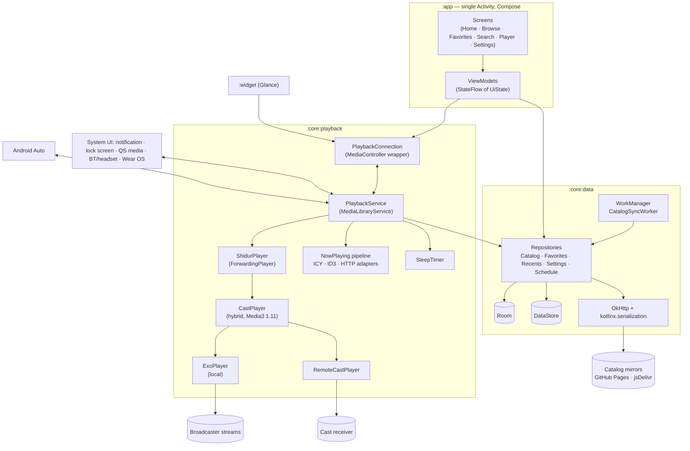
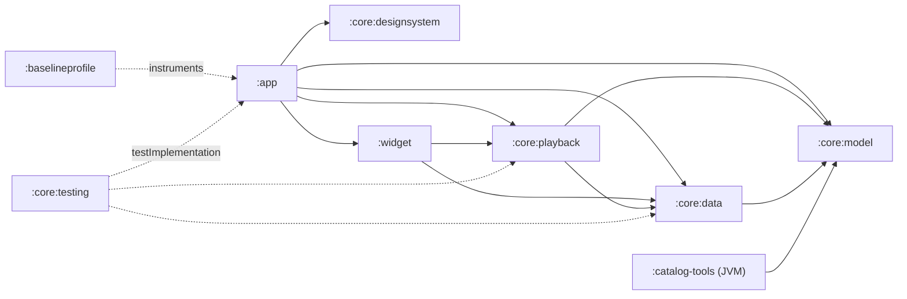

# SPEC-03 · Technical Architecture

| | |
|---|---|
| **Status** | Draft v0.1 — for review |
| **Date** | 2026-10-26 |
| **Related** | [Overview](SPEC.md) · [01 Product](SPEC-01-product.md) · [02 Design](SPEC-02-design.md) · [04 Catalog](SPEC-04-catalog.md) · [05 Quality & Release](SPEC-05-quality-release.md) |

---

## 1. Architecture overview

**Principles**

1. **The media session is the single source of truth for playback.** The UI, widget, notification, Android Auto, Wear OS, and Bluetooth all observe and control the same `MediaLibrarySession`. No component keeps its own copy of playback state.
2. **Offline-first data.** Room is what the UI reads. Network refreshes write into Room. A catalog snapshot is bundled in the APK.
3. **Station quirks are data, not code.** Stream lists, fallbacks, metadata parsing rules, and now-playing adapters come from the catalog ([SPEC-04](SPEC-04-catalog.md)). The app stays generic.
4. **Unidirectional data flow.** Each screen has one ViewModel exposing `StateFlow<UiState>` and accepting events. Composables stay stateless where practical.
5. **Optional dependencies are isolated.** Google Cast (proprietary Play services) sits behind an interface in its own source set, so a FOSS flavor stays possible.

## 2. Technology stack

Versions were checked against official release pages on **2026-10-26**.

| Concern | Choice | Version (2026-10-26) | Notes |
|---|---|---|---|
| Language | **Kotlin** (K2) | 2.4.21 | JDK 21 toolchain; KSP for annotation processing |
| Build | **Android Gradle Plugin**, Gradle Kotlin DSL, version catalog, `build-logic` convention plugins | AGP 9.3.3 | |
| UI | **Jetpack Compose** (BOM) | Compose 1.12.1 | |
| Material | **Compose Material 3** | 1.5.0-beta02 (stable: 1.4.0) | The Expressive components (`ButtonGroup`, `LoadingIndicator`, flexible/floating toolbars, …) remain **`@ExperimentalMaterial3ExpressiveApi` in 1.5**. Opt in **only inside `:core:designsystem`** and pin the version (spike S-4) |
| Adaptive | `material3-adaptive` / `material3-adaptive-navigation-suite` | 1.3.0 / 1.5.0-beta02 | Pane scaffolds (`SupportingPaneScaffold`) and `NavigationSuiteScaffold` |
| Navigation | **Navigation Compose** with type-safe (`@Serializable`) routes | 2.10.2 | Navigation 3 is stable (1.2.0), but its adaptive companion is still alpha. Revisit Nav3 after 1.0 |
| DI | **Hilt** (+ `hilt-navigation-compose`, `hilt-work`) | Dagger/Hilt 2.60.1 · AndroidX Hilt 1.4.0 | |
| Concurrency | Kotlin coroutines + Flow | — | |
| Playback | **Media3**: `exoplayer`, `exoplayer-hls`, `session`, `datasource-okhttp`, `cast` | 1.11.1 | `MediaLibraryService` serves Android Auto and controllers |
| Persistence | **Room** (KSP) + **DataStore** (Preferences) | 2.8.5 · 1.3.0 | |
| Networking | **OkHttp** + **kotlinx.serialization-json** | latest stable | No Retrofit; only a handful of GET endpoints |
| Images | **Coil 3** (`coil-compose`, `coil-network-okhttp`) | 3.6.3 | Shares the OkHttp client and disk cache |
| Color | **material-color-utilities** (Apache-2.0) | latest | Station schemes ([SPEC-02 §2.3](SPEC-02-design.md#23-station-tinted-player)), contrast levels, harmonization |
| Background work | **WorkManager** | 2.12.0 | Catalog and schedule refresh |
| Widget | **Glance** `appwidget` + `glance-material3` | 1.2.0 | |
| Cast | `play-services-cast-framework` + `androidx.mediarouter` + `media3-cast` | Media3 1.11.1 | Isolated ([§8](#8-google-cast)) |
| Crash reports | **ACRA** (`acra-mail`, `acra-dialog`) | latest | Opt-in per report ([SPEC-05 §7](SPEC-05-quality-release.md#7-crash-reporting-acra-opt-in-per-report)) |
| OSS notices | **AboutLibraries** | latest | |
| Testing | JUnit 4, Truth, Turbine, Robolectric, **Roborazzi**, Compose UI Test, MockWebServer, Media3 test-utils, Macrobenchmark, Baseline Profile plugin, Kover | latest | [SPEC-05 §1](SPEC-05-quality-release.md#1-test-strategy) |
| Static analysis | Detekt (+ Compose rules), Spotless/ktlint, Android Lint | latest | |

**SDK levels**

- **minSdk 31** (Android 12). This is well above the AndroidX floor, which is now 23–24.
- **compileSdk / targetSdk 36** (Android 16). Google Play requires API 36 for new apps and updates from **2026-11-01**. API 37 (Android 17) documentation is live, but its release status was ambiguous on 2026-10-26; bump once it is stable.

> **Version policy:** exact versions live in `gradle/libs.versions.toml` and are refreshed at M0. Use stable releases, except Material3 1.5.x until it goes stable. Renovate keeps them current.

## 3. Modules

| Module | Type | Responsibilities |
|---|---|---|
| `:app` | Android app | `MainActivity`, navigation, all screens and ViewModels (one package per feature: `home`, `browse`, `favorites`, `search`, `player`, `settings`, `onboarding`, `customstation`), Hilt graph, deep links, ACRA setup |
| `:core:model` | **Pure Kotlin/JVM** | Domain models and `@Serializable` catalog DTOs; search normalization; schedule time logic. Shared with `:catalog-tools`. No Android dependencies |
| `:core:data` | Android library | Room DB, DataStore, `CatalogRepository` (snapshot import, remote sync, tombstones), `FavoritesRepository`, `RecentsRepository`, `CustomStationRepository`, `SettingsRepository`, `ScheduleRepository`, `SearchIndex`, `CatalogSyncWorker`, OkHttp/Coil singletons |
| `:core:playback` | Android library | `PlaybackService`, `ShidurPlayer`, `StreamResolver`, fallback/retry policy, now-playing pipeline, `SleepTimer`, Android Auto browse tree, `ArtworkProvider`, playback resumption, Bluetooth/headset auto-resume, data-saver policy, `PlaybackConnection`; Cast in its own source set |
| `:core:designsystem` | Android library | `ShidurTheme` (dynamic, brand, pure black, station scheme), typography (Heebo), shapes, motion, icons, wrappers for Expressive components, shared components (`StationTile`, `StationRow`, `MiniPlayer`, `PlayPauseButton`, `MonogramArtwork`, …) taking plain parameters, not domain types |
| `:core:testing` | Android library (test-only) | Fakes for repositories and the player, MockWebServer stream fixtures (ICY/HLS/PLS), Compose test rules, screenshot-test helpers |
| `:widget` | Android library | Glance widget, its state store, and action callbacks |
| `:baselineprofile` | `com.android.test` | Baseline and startup profile generation; Macrobenchmarks |
| `:catalog-tools` | Kotlin/JVM app | CLI: `validate`, `build`, `probe`/`health`, `rb-sync`, `schedules`, `site` ([SPEC-04 §6](SPEC-04-catalog.md#6-automation-github-actions)) |
| `build-logic` | Included build | Convention plugins: `shidur.android.application`, `.library`, `.compose`, `.hilt`, `.room`, `.jvm`, `.detekt`, … |

Package root: `io.github.<owner>.shidur` (open question Q-01).

## 4. UI layer & navigation

- **Activity:** a single `MainActivity : AppCompatActivity`. AppCompat is required for the per-app language backport on Android 12. It calls `installSplashScreen()` and `enableEdgeToEdge()`.
- **Root composable:** `ShidurApp()` = `ShidurTheme` → `NavigationSuiteScaffold` (bar or rail by window size) → `NavHost` + mini-player. On expanded widths, `SupportingPaneScaffold` hosts the player pane. Layout per [SPEC-02 §4](SPEC-02-design.md#4-navigation--adaptive-layout).
- **Routes:** type-safe `@Serializable` routes: `Home`, `Browse(collectionId?)`, `Favorites`, `Search(query?)`, `Player(stationId?, autoplay=false)`, `Settings`, `AutoResumeSettings`, `CustomStations`, `AddCustomStation(url?)`, `About`, `Onboarding`. Deep links map onto these routes ([§11](#11-deep-links--sharing)).
- **ViewModels:**
  - `@HiltViewModel` classes `combine` repository flows with `PlaybackConnection.state`, then `stateIn(viewModelScope, WhileSubscribed(5_000), initial)`.
  - Events are plain functions (`onStationClick(id)`); one-off effects (snackbars, share intents) use a `Channel`.
- **`PlaybackConnection`** (singleton) — the bridge between UI and the media session:
  - wraps an async-connected `MediaController` bound to `PlaybackService`;
  - exposes `StateFlow<PlayerUiState>`: station, queue context, `isPlaying`, buffering/reconnecting, error, now playing, sleep-timer remaining, cast state, stream info;
  - commands: `play(stationId, context)`, `toggle()`, `next()`, `previous()`, `setSleepTimer(…)`, `toggleFavorite()`.
- **Station colors:** `StationSchemeProvider` decodes the logo through Coil, extracts a seed off the main thread, builds the scheme, and caches by `(stationId, logoHash, mode, contrast)`.
- **Bidi helper:** `bidiIsolate(text)` wraps interpolated user or station content (FSI…PDI). Metadata `Text`s use `TextDirection.Content` ([SPEC-02 §7](SPEC-02-design.md#7-localization--bidirectional-text)).

## 5. Playback

### 5.1 Service & player

- **`PlaybackService : MediaLibraryService`:**
  - declared with `android:foregroundServiceType="mediaPlayback"`;
  - exported with intent filters for `androidx.media3.session.MediaLibraryService` and `android.media.browse.MediaBrowserService` (Android Auto and legacy controllers).
- **`ShidurPlayer : ForwardingPlayer`** wraps Media3's hybrid `CastPlayer`, which in turn wraps the local `ExoPlayer` and a `RemoteCastPlayer` ([§8](#8-google-cast)). In a Cast-free build it wraps `ExoPlayer` directly. It handles:
  - **Metadata:** composes `MediaMetadata` from station + now playing (title/artist mapping per [SPEC-02 §6.1](SPEC-02-design.md#61-media-notification--lock-screen)), with `mediaType = MEDIA_TYPE_RADIO_STATION` and `artworkUri = content://…/logo/{id}`.
  - **Commands:** removes seek commands (live streams have no timeline) and maps previous/next onto the queue (previous/next station).
  - **Live semantics:** on `pause()`, a 10-second grace timer starts; after it, the player calls `stop()` to release the network (NFR-05). `play()` after a stop re-prepares at the live edge (F-05 R6).
- **ExoPlayer configuration:**
  - `setAudioAttributes(USAGE_MEDIA / AUDIO_CONTENT_TYPE_MUSIC, handleAudioFocus = true)`. MUSIC is used even for talk stations, so navigation prompts **duck** instead of pausing — paused live audio is lost for good.
  - `setHandleAudioBecomingNoisy(true)` and `setWakeMode(C.WAKE_MODE_NETWORK)`.
  - `DefaultMediaSourceFactory(OkHttpDataSource.Factory(okHttp).setUserAgent(UA))` with a **custom `LoadErrorHandlingPolicy`**. Media3's default policy gives up after a few retries (≈15–30 s), which is too little for 24/7 radio.
  - Cleartext must be allowed in the network security config ([§12.2](#122-platform-requirements-latest-targetsdk)). Otherwise HTTP-only stations fail with `CleartextNotPermittedException`, which Media3 treats as non-retriable.
  - `DefaultLoadControl` tuned for **fast start**: ≈1 s buffer before playback, ≈3 s after a rebuffer. A data-saver variant uses a smaller maximum buffer.
- **Queue:** the Media3 playlist is the current *context* (Favorites, a collection, Recents, or search results) with `REPEAT_MODE_ALL`. Each `MediaItem.mediaId` is a station ID. `onAddMediaItems` / `onSetMediaItems` resolve IDs into playable items, so Auto, the widget, Assistant, and resumption can all send bare IDs.

### 5.2 Stream resolution & resilience

- **`StreamResolver`** picks the stream for the current conditions:
  1. Filter the catalog streams by health and by Cast compatibility (when casting).
  2. Order them by data-saver policy (lowest bitrate first when active), then by priority.
  3. Resolve `.pls` / `.m3u` playlists itself: download ≤ 16 KB and take the first `http(s)` entry. Pass a MIME hint for HLS.
- **Retry & fallback (`StreamFallbackController`):**
  - on network, IO, or HTTP errors: retry the same URL with backoff (1 → 2 → 4 → 8 s);
  - then switch to the next URL;
  - after all URLs fail: error state with *Retry · Try another stream · Report*;
  - a `ConnectivityManager` network callback triggers an immediate retry when connectivity returns;
  - the whole sequence is bounded to about 2 minutes (F-05 R7).
- **Diagnostics:** the last error code, the URL tried, and timings are kept for *Report a problem* (F-19). They are never uploaded automatically.

### 5.3 Now-playing pipeline (F-06)

1. **In-stream:** `Player.Listener.onMetadata` receives `IcyInfo` (ICY `StreamTitle`) and ID3 `TextInformationFrame` (TIT2/TPE1) for HLS.
2. **Charset handling:** Media3's ICY decoder is hardcoded to UTF-8 with an ISO-8859-1 fallback and can't be configured ([ExoPlayer #6753](https://github.com/google/ExoPlayer/issues/6753), [#10254](https://github.com/google/ExoPlayer/issues/10254)). Hebrew sent as Windows-1255 would arrive garbled. Instead, **decode `IcyInfo.rawMetadata` ourselves**:
   - extract `StreamTitle='…';` from the raw bytes;
   - decode with the station's declared charset;
   - for `auto`: valid UTF-8 → UTF-8, else Windows-1255.

   Fixture tests cover both encodings.
3. **Parse:** apply the station's `pattern` (named groups `artist` / `title`) and `ignore` regexes, trim, and drop duplicates.
4. **HTTP adapters:** `NowPlayingPoller` runs only while that station plays. It polls each declared `httpJson` / `httpXml` adapter at `pollSeconds` (≥ 20 s), with backoff on errors. Responses are capped at 64 KB, requests must be HTTPS, and field paths are a tiny safe subset ([SPEC-04 §7.2](SPEC-04-catalog.md#72-design-real-time-data-in-the-app-schedules-in-the-pipeline)).
5. **Fallback:** the current program from `ScheduleRepository`.
6. **Publish:** `ShidurPlayer` re-emits `MediaMetadata`, which updates the notification, lock screen, Auto, Wear OS, and widget. `PlaybackConnection` exposes the same value to the UI.

### 5.4 Sleep timer (F-07)

- Lives in the service and is driven by custom session commands: `SET_SLEEP_TIMER(durationMs | END_OF_PROGRAM)`, `EXTEND_SLEEP_TIMER`, `CANCEL_SLEEP_TIMER`.
- Uses `SystemClock.elapsedRealtime()` and a coroutine in the service scope.
- During the final 30 s it ramps `player.volume` down (fade-out), then pauses, stops, and restores the volume.
- The remaining time is published through **session extras**, so the UI and widget render the countdown without polling.

### 5.5 Custom commands & media buttons

| Command | Surfaces |
|---|---|
| `FAVORITE_TOGGLE` | Notification, lock screen, Android Auto (heart icon via media button preferences) |
| `SET/EXTEND/CANCEL_SLEEP_TIMER` | App UI |
| `PLAY_STATION(id, context)` | Widget, deep links, auto-resume |

Privileged custom commands are accepted only from Shidur's own package and trusted system controllers (checked via `ControllerInfo` in `onConnect`).

### 5.6 Playback resumption (F-05 R8, F-14 R5)

- `MediaSession.Callback.onPlaybackResumption()` returns the last station and context from DataStore. Resumption is **off by default** in Media3, and Media3 persists nothing itself, so the app saves the last station and context on every change.
- Media3's `MediaButtonReceiver` is declared for `android.intent.action.MEDIA_BUTTON`.
- This enables the system *resume media* card after a reboot, and lets the Play button on a headset or car (including head units that send PLAY on connect) restart the last station **without any permission**.

### 5.7 Data saver (F-13)

- **`NetworkPolicyMonitor`:** a default-network callback reading `NET_CAPABILITY_NOT_METERED`, plus `ConnectivityManager.getRestrictBackgroundStatus()` (the system Data Saver).
- **Effective mode** = the user setting combined with network state. It drives:
  - the stream order in `StreamResolver`;
  - `TrackSelectionParameters.setMaxAudioBitrate(64_000)` for HLS;
  - the smaller `LoadControl`;
  - small logo URLs in Coil;
  - `NetworkType.UNMETERED` constraints on refresh workers (except first run).
- A network change during playback doesn't interrupt the current stream; it takes effect on the next start or reconnect, to avoid audible glitches.
- **Reality check:** most Israeli streams are a single Icecast bitrate. Data saver therefore only changes playback where the catalog lists a lower-bitrate variant or the stream is multi-rendition HLS. The setting still saves data on logos and refreshes everywhere.

## 6. Data layer

### 6.1 Storage

**Room — `shidur.db`**

| Table | Contents |
|---|---|
| `stations` | Catalog stations: id, JSON payload, plus indexed columns (network, status, rank, normalized search keys) |
| `collections`, `networks` | Taxonomy from the catalog |
| `favorites` | `stationId` (PK), `position` (dense integers, rewritten in one transaction on reorder) |
| `recents` | `stationId` (PK), `lastPlayedAt`; trimmed to 20 |
| `custom_stations` | id (`custom-<uuid>`), name, streamUrl, logoUrl, collectionId, createdAt |
| `search_history` | query (PK), lastUsedAt; trimmed to 10 |
| `schedule_items`, `schedule_meta` | Cached schedules + `validUntil` |
| `station_schemes` | Cached station color seeds (`stationId`, `logoHash`, `seedArgb`) |

Migrations are tested; schema JSON is exported to the repo.

**DataStore (Preferences)**

- Appearance: theme, pure black, dynamic color.
- Playback: data-saver mode, auto-resume (wired on/off and the enabled CDM association IDs), sleep fade-out.
- Privacy and onboarding: crash-report mode, onboarding done.
- Session: last station and queue context.
- Sync: catalog `ETag`/version, last sync time, update-check settings (GitHub builds).

**Backup:** device-to-device transfer **on**, cloud backup **off** — consistent with D-04 (everything stays on the device). Uses `dataExtractionRules`; caches are excluded.

### 6.2 Catalog sync (F-18)

1. **First launch:** if Room has no stations, import `assets/catalog/catalog.json` in a single transaction.
2. **`CatalogSyncWorker`:**
   - periodic every 24 h, needing a connected network (unmetered when data saver is *Always*);
   - also enqueued as expedited work on app start when the last success is more than 24 h old, and from *Check now*.
3. **Fetch:** try the mirrors in order ([SPEC-04 §8](SPEC-04-catalog.md#8-how-the-app-consumes-the-catalog)) with `If-None-Match`.
4. **Validate** (schema major, newer `catalogVersion`, mass-deletion guard), then upsert in one transaction and apply tombstones (`replacedBy` migrates favorites and recents).
5. **On any failure,** keep the current catalog and retry with WorkManager backoff.

### 6.3 Search (F-02)

- An in-memory index is rebuilt whenever the catalog changes; it is small (≤ 1,000 entries).
- Normalization lives in `:core:model` and is unit-tested:
  - strip niqqud and cantillation marks (U+0591–U+05C7);
  - map final letters to base forms;
  - strip geresh/gershayim and ASCII quotes;
  - lowercase and NFKD-strip diacritics for Latin text;
  - generate frequency forms (`88`, `88.0`, `88fm`).
- The ranking rules from F-02 R4 apply.

### 6.4 Schedules (F-12)

- **Sources:** `schedules/v1/all.json` (today and tomorrow for every station; ≈10 KB gzipped) feeds Home's *On now* and the station rows. Per-station files are fetched when the schedule sheet opens.
- **Refresh:** cached until `validUntil`, refreshed at most every 6 h while the app is in use.
- **Current/next calculation** happens on the client with `java.time` in `Asia/Jerusalem`, then displays in the device zone ([F-12 R2](SPEC-01-product.md#f-12-program-schedule)).

### 6.5 Images & artwork

- **Coil 3:** one `ImageLoader` on the shared OkHttp client, with a 50 MB disk cache and a memory cache.
- **`ArtworkProvider`:** a read-only `ContentProvider` that serves cached, square-composited logos at `content://<authority>/logo/{stationId}`. The notification, Android Auto, and system media controls all use it, so they never fetch remote URLs themselves. It serves only public logos.

## 7. Android Auto

- **Manifest:** `com.google.android.gms.car.application` meta-data → `automotive_app_desc.xml` containing `<uses name="media"/>`.
- **Browse tree** (`MediaLibrarySession.Callback`):
  - **Root:** search supported; root children shown as tabs.
  - **Favorites:** playable items in a grid content style.
  - **Recent:** playable items in a list.
  - **Categories:** browsable collections, each listing stations, with frequency as the subtitle.
- **Search and voice:**
  - `onSearch` / `onGetSearchResult` use the same `SearchIndex` as the app.
  - Voice requests ("play X on Shidur") arrive as a `MediaItem` carrying `requestMetadata.searchQuery`. `onSetMediaItems` resolves it to the best match and builds a queue of that match plus the rest of its collection.
- **Artwork:** `content://` URIs from `ArtworkProvider`.
- **Errors:** playback errors map to session errors with readable messages, plus a resolution action where possible (e.g. *Retry*).
- **Testing:** with the DHU. For sideloaded builds, the user must enable *Unknown sources* in Android Auto's developer settings ([§14](#14-distribution-constraints)).

## 8. Google Cast

- **Dependencies:** `play-services-cast-framework`, `androidx.mediarouter`, and `media3-cast` (Media3 1.11.1).
- **Receiver:** a `CastOptionsProvider` using the **Default Media Receiver**, which needs no receiver registration.
- **Player:** Media3's rewritten **`CastPlayer`** (shipped in Media3 1.11.1, `@UnstableApi`) is itself a `ForwardingPlayer`. It wraps the local `ExoPlayer` plus a `RemoteCastPlayer`, and **transfers playback automatically** when a Cast session starts or ends. `ShidurPlayer` wraps this hybrid player, so the media session never swaps players by hand. Two policies are added on top:
  - when a session starts, re-resolve the current station to its **cast-compatible** stream (catalog `capabilities.castCompatible`);
  - when a session ends, intercept the transfer back to local playback and leave it **paused** (F-10 R4).
- **Stream constraints:**
  - The receiver is a web (Chrome) context. Plain-HTTP streams are effectively blocked as mixed content; no official doc states this outright, so spike S-2 confirms it.
  - HLS additionally needs CORS headers (`Access-Control-Allow-Origin`) on playlists and segments.
  - HTTP-only stations are **not castable**. Shidur will **never** proxy streams to work around this ([D-19](SPEC.md#decision-log)); the UI explains instead.
- **Isolation:**
  - all Cast code lives in a `cast` source set behind a `RemotePlaybackController` interface, with a no-op implementation (the pattern AntennaPod uses), so a FOSS flavor is easy to add later;
  - when `GoogleApiAvailability` reports no Play services, the Cast UI is hidden.
- **UI:** `MediaRouteButton` is wrapped for Compose (`AndroidView`) and uses an M3-themed context.

## 9. Auto-resume (Bluetooth & headphones)

**Key constraint (verified 2026-10-26).** Since Android 12, an app in the background may start a foreground service (and therefore playback) only in listed exempt situations. **Bluetooth broadcasts are not on that list.** A manifest receiver for `ACTION_ACL_CONNECTED` or A2DP state changes can wake a killed app — those broadcasts are exempt from the *implicit-broadcast* limits — but it **cannot start playback**. Two exemptions do fit:
- the **Companion Device Manager (CDM)**, with `REQUEST_COMPANION_START_FOREGROUND_SERVICES_FROM_BACKGROUND`;
- *"the user turns off battery optimizations for your app."*

Source: [Restrictions on starting a foreground service from the background](https://developer.android.com/develop/background-work/services/fgs/restrictions-bg-start).

| Path | Mechanism | Permission / setup | Works when the app is killed? |
|---|---|---|---|
| **Baseline** (always on) | Playback resumption ([§5.6](#56-playback-resumption-f-05-r8-f-14-r5)): the car or headset sends PLAY | None | **Yes** |
| **Auto-start on a chosen Bluetooth device** (opt-in, F-14a) | **CDM association** through the system device picker → `startObservingDevicePresence` → the system binds Shidur's `CompanionDeviceService` when the associated device connects (`onDeviceAppeared`, or `onDevicePresenceEvent` on API 36+) → start playback | Normal permissions `REQUEST_COMPANION_START_FOREGROUND_SERVICES_FROM_BACKGROUND` and `REQUEST_OBSERVE_COMPANION_DEVICE_PRESENCE`, plus the user's choice in the **system CDM dialog**. No `BLUETOOTH_CONNECT` needed | **Yes** (spike S-3 verifies presence events for Bluetooth Classic car kits on Pixel and Samsung) |
| **Wired headphones** (opt-in, F-14b) | `AudioDeviceCallback` registered while the process is alive (`ACTION_HEADSET_PLUG` can't be declared in the manifest) | None | **No**, by platform design |

**Presence handling (`ShidurCompanionService`):**
1. The feature is on, and the device's association is enabled.
2. No call is in progress (`AudioManager.mode` is not in-call or in-communication). This avoids needing phone-state permission.
3. Not already playing, and it hasn't auto-started for this connection yet (debounced per connect event).
4. Connect a `MediaController` → `play()` the last station. Media3 then promotes the service to the foreground.

**Fallback if S-3 shows unreliable presence events on some OEMs:** a manifest A2DP receiver (component-disabled unless opted in). It can start playback only when the user has set Shidur's battery usage to *Unrestricted*. The settings page explains this and links to the app-details settings. Shidur never requests the restricted *ignore battery optimizations* permission.

**OEM caveat:** aggressive battery managers (Samsung, Xiaomi, and others) may still interfere. This is documented in the in-app help.

## 10. Home-screen widget & Wear OS

### 10.1 Widget (F-09)

- **`ShidurWidget : GlanceAppWidget`:** `SizeMode.Responsive` with small, medium, and large layouts ([SPEC-02 §6.3](SPEC-02-design.md#63-home-screen-widget)). Uses `GlanceTheme` with dynamic colors, or brand `ColorProviders` when dynamic color is off.
- **State:** the service writes a compact `WidgetState` (station, playing flag, now-playing text, top 8 favorites) to Glance state, then calls `updateAll()`, debounced to at most one update per second. Updates are **push-only**: `updatePeriodMillis` has a 30-minute floor and isn't used for playback state.
- **Actions:**
  - `actionRunCallback<PlayStation>` and `actionRunCallback<TogglePlayback>` connect a `MediaController` and send commands (a widget tap is a user interaction, so it may start the foreground service);
  - tapping the body opens `MainActivity` → `Player`.
- **Bitmaps:** logos are loaded in `provideGlance` at ≤ 128 px, within RemoteViews bitmap memory limits.

### 10.2 Wear OS (F-16)

- **v1:** no Wear module. A paired watch **automatically** shows system media controls for the phone's `MediaSession` — Media3 lists the Wear OS watch among the surfaces a session drives, with no Wear app required. The controls mirror metadata, artwork, play/pause, previous/next, and volume. Shidur's job is to provide clean metadata, artwork, and commands. Verified on a Wear OS emulator paired with a phone emulator, and on a real watch if available.
- **Backlog:** a `:wear` module built on Compose for Wear OS (Material 3) and Horologist media components (favorites list, tile, complication).

## 11. Deep links & sharing

- **Share URL:** `https://<owner>.github.io/shidur/s/{stationId}`. The catalog pipeline generates a static landing page for each station ([SPEC-02 §6.6](SPEC-02-design.md#66-share-landing-page-github-pages)).
- **Opening the app:**
  - **App Links:** `MainActivity` has an `autoVerify` intent filter for host `<owner>.github.io` with path prefix `/shidur/s/`. Verification needs `assetlinks.json` at the **host root** (`https://<owner>.github.io/.well-known/assetlinks.json`), so it is published from the user-site repository `<owner>/<owner>.github.io`. Jekyll skips dot-folders by default, so that repo's `_config.yml` needs `include: [".well-known"]` (or a `.nojekyll` file). This setup is confirmed working on live github.io sites; spike S-5 only confirms it for our package.
  - **Custom scheme** `shidur://station/{id}` as a fallback. The landing page's *Open in Shidur* button uses an `intent:` URL whose fallback is the GitHub Releases page.
- **Handling:** the link navigates to `Player(stationId, autoplay = false)`. Unknown IDs show a message and open Browse.
- **Share text:** localized, and includes the station name, frequency, and URL. *Share song* adds the now-playing text.

## 12. Permissions & platform requirements

### 12.1 Permissions

| Permission | Why | When |
|---|---|---|
| `INTERNET`, `ACCESS_NETWORK_STATE` | Streams, catalog, metered-network detection | Install time |
| `FOREGROUND_SERVICE`, `FOREGROUND_SERVICE_MEDIA_PLAYBACK` | Background playback (`foregroundServiceType="mediaPlayback"`; no runtime prerequisites) | Install time |
| `WAKE_LOCK` | `WAKE_MODE_NETWORK` while playing | Install time |
| `REQUEST_COMPANION_START_FOREGROUND_SERVICES_FROM_BACKGROUND`, `REQUEST_OBSERVE_COMPANION_DEVICE_PRESENCE` | Auto-start when an associated car or headset connects (F-14a, [§9](#9-auto-resume-bluetooth--headphones)) | Install time (normal). They only take effect after the user associates a device in the system CDM dialog |

**Not requested:**
- `POST_NOTIFICATIONS`: notifications tied to a media session are exempt from the notification runtime permission. The update notice is an in-app banner. No other notifications exist.
  - **M0 check:** Google doesn't spell out how the exemption applies to a Media3 notification. Deny the permission on Android 13+, start playback, and verify the notification, lock-screen, and Quick Settings media controls all appear.
  - If they don't, request the permission in context on the first playback, with an explanation.
- `BLUETOOTH_CONNECT`: the CDM system picker handles device selection.
- Location, phone state, and storage permissions.
- `RECEIVE_BOOT_COMPLETED`: resumption is handled by the system, and widget state is persisted.

### 12.2 Platform requirements (latest targetSdk)

| Requirement | How Shidur complies |
|---|---|
| Edge-to-edge enforced (API 35+; API 36 removes the opt-out) | `enableEdgeToEdge()`, insets handled in every scaffold |
| Predictive back (API 36: `onBackPressed()` / `KEYCODE_BACK` no longer delivered) | Compose `BackHandler` / `PredictiveBackHandler` only, including the player collapse; no legacy back handling anywhere |
| Large screens (API 36): orientation/resizability/aspect-ratio restrictions ignored on ≥ 600 dp | Fully adaptive layouts; no locked orientation |
| 16 KB memory page size (Play blocks non-compliant **updates** from **2027-02-01**) | No native code in Shidur; CI audits dependencies for native libraries (APK Analyzer / `zipalign -P 16` check) |
| Foreground service types | `mediaPlayback` declared; Media3 handles `startForeground` timing |
| Per-app languages | `generateLocaleConfig = true`; `AppCompatDelegate.setApplicationLocales` (works before and after API 33); `autoStoreLocales` for Android 12 |
| Cleartext streams | `network_security_config` allows cleartext (many streams are HTTP-only, and Media3 won't retry `CleartextNotPermittedException`). Catalog, schedule, adapter, and update requests are **HTTPS-only**, enforced in code (NFR-12) |
| Splash screen | Native SplashScreen API (minSdk 31) |

## 13. Networking & security

- **One OkHttp client:**
  - `User-Agent` interceptor (`Shidur/<version> (Android <release>; +https://github.com/<owner>/shidur)`);
  - a 10 MB HTTP cache for JSON;
  - API timeouts: connect 10 s, read 15 s.
- **Streams:** use the same client through `OkHttpDataSource`, with stream-appropriate timeouts.
- **No certificate pinning:** GitHub and jsDelivr rotate certificates, so pinning would be brittle. Integrity comes from catalog validation (and signing in 1.1).
- **Untrusted input** (custom-station URLs, playlists, adapter responses): only `http`/`https` schemes, length limits, size-capped downloads, no redirects to non-HTTP schemes. No WebView anywhere.
- **Exported components** are kept to the minimum:
  - `MainActivity` (launcher + links);
  - `PlaybackService` (media browser);
  - `MediaButtonReceiver`;
  - `ShidurCompanionService` (bound only by the system, protected by `BIND_COMPANION_DEVICE_SERVICE`), plus the optional fallback A2DP receiver (disabled unless opted in);
  - `ArtworkProvider` (read-only, public logos only).
- **Release builds:** R8 full mode with resource shrinking, plus Gradle dependency verification.

## 14. Distribution constraints

Checked on 2026-10-26 against official Google documentation.

### 14.1 Android developer verification (applies to GitHub-distributed APKs)

Google now requires apps installed on certified Android devices to come from a **registered developer**, even when installed **outside Google Play** ([developer.android.com/developer-verification](https://developer.android.com/developer-verification)).

| Date | Milestone |
|---|---|
| Mar 2026 | Registration opened to all developers |
| Jun–Aug 2026 | Limited-distribution tier and the user "advanced flow" rolled out |
| **2026-09-30** | Enforcement began in Brazil, Indonesia, Singapore, and Thailand (for installs from named app stores) |
| **2027 →** | **Global rollout to all apps on certified devices.** No Israel-specific date has been published |

**Account tiers and user options:**

| Option | What it means | Fit for Shidur |
|---|---|---|
| **Limited distribution** | Free, no ID; up to **20 devices**, each invited with a link that expires after 7 days | Alpha/beta testers |
| **Full distribution** | **One-time US $25** + government ID + proof of address. Register the package name and the **SHA-256 fingerprint** of the signing certificate in the *Android Developer Console* (separate from Play Console) | **Required for public GitHub releases** once enforcement reaches Israel |
| **Advanced flow** (for users) | Lets users install unverified apps after enabling developer mode, a 24-hour wait, and re-authentication | A last resort; too much friction to rely on |
| **ADB installs** | Never affected | Development unaffected |

- Open-source repositories that re-sign apps (like F-Droid) can have their key added to the developer's registration.

**Plan:**
1. Register **Full distribution** for `io.github.<owner>.shidur` with the release key's fingerprint **before 1.0** (M5).
2. Re-check the Israel timeline at each release.

**Unverified:** whether one $25 fee covers both the Android Developer Console and Play Console.

### 14.2 Google Play (later)

- **Account:** one-time US $25. New **personal** accounts must run a **closed test with ≥ 12 testers opted in for 14 consecutive days** before production access.
- **Signing:** Play App Signing can import the **existing** app signing key via **PEPK**, so Play and GitHub APKs share one signature ([SPEC-05 §5](SPEC-05-quality-release.md#5-signing--key-management)).
  - New Play apps are now auto-enrolled in *quantum-ready hybrid signing* (RSA + ML-DSA, APK Signature Scheme v3.2, Android 17+). Confirm at onboarding that this keeps parity with GitHub-signed APKs.
- **Android Auto:** voice "play X" search is a **mandatory** car quality requirement (VC-1), and Shidur implements it ([§7](#7-android-auto)).

### 14.3 Other constraints

| Topic | Impact | Plan |
|---|---|---|
| **Android Auto with sideloaded APKs** | Android Auto shows sideloaded media apps only when the user enables *Unknown sources* in Android Auto's developer settings. Google documents this as a testing feature | Document it in the README/FAQ; general availability comes with Play |
| **F-Droid** | The proprietary Cast SDK isn't allowed | Not planned; the Cast isolation in [§8](#8-google-cast) keeps a `foss` flavor cheap |

## 15. Technical spikes

The open technical questions are tracked as time-boxed M0 spikes S-1…S-6 in [SPEC-06 §2](SPEC-06-roadmap-risks.md#2-technical-spikes-m0-time-boxed): metadata, Cast formats, Bluetooth auto-start, Expressive APIs, App Links on github.io, and the Android Auto browse tree.
