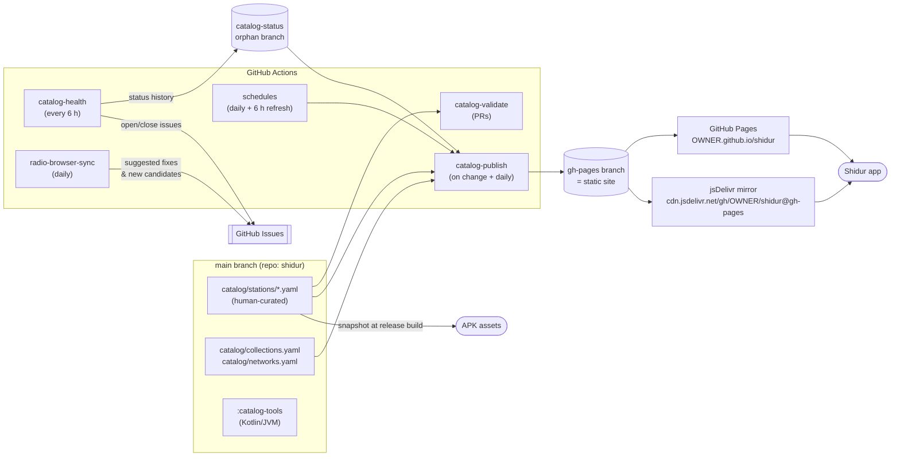

# SPEC-04 · Station Catalog & Data Pipeline

| | |
|---|---|
| **Status** | Draft v0.1 — for review |
| **Date** | 2026-10-26 |
| **Related** | [Overview](SPEC.md) · [01 Product](SPEC-01-product.md) (F-06, F-12, F-18) · [03 Architecture](SPEC-03-architecture.md) · [05 Quality & Release](SPEC-05-quality-release.md) |

This document defines where Shidur's stations come from, how the list stays correct over time with **$0 cost and ≈1 h/month of maintainer time**, and how the app consumes it. Research was done on 2026-10-26; stream URLs are **seed data to verify**, not guarantees.

---

## 1. Requirements recap

- **Coverage:** all Israeli licensed FM stations plus notable Israeli digital stations (G1).
- **Accuracy over time:** ≥ 97% of stations healthy on any day (G2). Broken streams are detected and fixed without an app release (F-18).
- **Rich data:** he/en names, aliases, frequencies, logos, collections, multiple stream URLs, now-playing and schedule hints (F-01, F-02, F-06, F-12).
- **Operations:** $0 running cost; mostly automated; community contributions via pull requests (G5).
- **Offline:** the app ships with a snapshot and works without the network, except for streaming (F-18).

## 2. Source evaluation

| Source | What it offers | Problems found | Role in Shidur |
|---|---|---|---|
| **[radio.mivzaklive.co.il](https://radio.mivzaklive.co.il/)** (the list the maintainer found) | 55 stations hardcoded in one static HTML page; URLs point directly at broadcasters/CDNs (no proxy) | An ad-funded portal (NodeTent) with no API and no license for reusing the list. Mixes in ~12 generic non-Israeli trance/dance relays. Visible duplicate ("נושמים מזרחית" ×2 with different URLs). Referral tags appended to URLs (`?mivzaklive`) | **Discovery leads only.** Never scraped or republished; every URL is re-verified |
| **[Radio Browser](https://api.radio-browser.info/)** (open community directory) | 186 IL entries (155 with `hidebroken=true`); mirrors found via DNS (`all.api.radio-browser.info`); daily `lastcheckok`; add/edit API | **~17% broken**; up to 9 duplicates per broadcaster (stale Kan mounts); filler entries; inconsistent names/tags/logos; **no explicit data license** | **Pipeline enrichment & drift detection.** Fixes are contributed back upstream. Not called by the app in v1 |
| **Official broadcaster sites** (kan.org.il, glz.co.il, 103fm.maariv.co.il, eco99fm.maariv.co.il, 100fm.co.il, …) | Authoritative stream URLs and schedules | Every site is different. Some URLs are semi-dynamic (103FM / 104.5FM embed the stream in `data-file` on `OnLineView.aspx`). glz.co.il sits behind Incapsula bot protection | **Primary source of truth** for URLs (human-verified) and for schedule adapters |
| **Second Authority for TV & Radio** (rashut2.org.il) | The authoritative list of regional licensees | Blocks automated fetches (HTTP 403) | Manual completeness check each quarter |
| **Wikipedia** — *Radio in Israel* (en/he) | Station list and per-region FM frequencies | Can be stale | Seed list and frequencies (facts only; no copied prose) |
| **Open-source projects**: Idan Plus (Kodi), `kodi-il/radio-il`, `ivrit-ai/explore` | Cross-checks for URLs and schedule-scraping approaches | **No license files**, so their data and code can't legally be imported | Reference only. The `kodi-il/logos-il` fair-use + takedown posture is the template for our logo policy |

**Decision: a hybrid curated catalog.** A human-curated source of truth lives in the repo. Automation runs health checks, detects drift against Radio Browser, scrapes schedules, and publishes the result. A snapshot is bundled in every APK.

## 3. Pipeline overview



- **Monorepo:** the app and catalog share one repository, `shidur`. GitHub Pages serves the catalog, schedules, logos, share landing pages, and the privacy policy from one origin.
- **History stays clean:** commits authored by automation go only to the `catalog-status` and `gh-pages` branches. `gh-pages` is force-pushed as a single commit on every publish, so it doesn't grow; its history lives in `main`.
- If contributor volume grows, `catalog/` can split into a `shidur-catalog` repo with no change for the app (the URLs stay on the same Pages origin, behind a redirect).

## 4. Repository layout

```
shidur/
├─ catalog/
│  ├─ stations/                 # one YAML per station → small, conflict-free PRs
│  │  ├─ kan-88.yaml
│  │  └─ …
│  ├─ networks.yaml             # operators: kan, idf, maariv-group, …
│  ├─ collections.yaml          # Browse chips: ids, he/en labels, order, membership rules
│  ├─ regions.yaml              # FM region enum: national, center, jerusalem, north, haifa, south, eilat, …
│  ├─ LOGOS.md                  # logo provenance + trademark notice + takedown contact
│  └─ LICENSE                   # CC0-1.0 for catalog data (logos excluded) — see §10
├─ catalog-tools/               # Kotlin/JVM CLI: validate · build · health · rb-sync · schedules · site
├─ site/                        # static templates: landing pages, privacy policy, takedown policy
└─ .github/
   ├─ workflows/                # catalog-*.yml (see §6)
   └─ ISSUE_TEMPLATE/           # suggest-station.yml, broken-stream.yml, wrong-info.yml
```

## 5. Data model

The Kotlin `@Serializable` models in `:core:model` are the **single source of truth** for both the app and `:catalog-tools`. A JSON Schema is generated from them so YAML editing gets validation and autocomplete (VS Code YAML language server).

### 5.1 Station source file (human-edited YAML)

Example values are illustrative and **verified at implementation time**.

```yaml
# yaml-language-server: $schema=../schema/station.schema.json
id: kan-88                       # stable slug; never reused or renamed (use replacedBy)
names:  { he: "כאן 88", en: "Kan 88" }
shortNames: { he: "88", en: "88" }
aliases: ["88fm", "kan88", "כאן88", "רשת 88"]   # search terms (F-02)
network: kan
collections: [music]             # network membership (kan) is implicit
languages: [he]
frequencies:
  - { mhz: 88.0, region: national }
website: https://www.kan.org.il/
logo:
  source: https://www.kan.org.il/…/kan88-logo.svg   # original asset (pipeline normalizes it)
  tileColor: "#101010"           # optional background for transparent logos
streams:                         # priority order; prefer stable redirectors (§11.3)
  - url: https://playerservices.streamtheworld.com/api/livestream-redirect/KAN_88.mp3
    format: mp3
    bitrateKbps: 128
  - url: https://kanliveicy.media.kan.org.il/icy/kan88_mp3
    format: mp3
    bitrateKbps: 128
  - url: https://kancdn.medonecdn.net/…/kan_88/…/playlist.m3u8
    format: hls
nowPlaying:                      # tried in order; capabilities confirmed by health checks
  - type: icy
    charset: auto                # auto | utf-8 | windows-1255
    pattern: '^(?<artist>.+?) - (?<title>.+)$'
    ignore: ['^כאן 88', '^Kan 88']
schedule:
  adapter: kan                   # pipeline adapter id (§7)
  params: { channel: "kan88" }
radioBrowser:
  uuids: []                      # mapped RB entries for drift detection & upstream fixes
geo: unknown                     # unrestricted | il-only | unknown
status: active                   # active | disabled | removed
replacedBy: null
editorialRank: 20                # lower = earlier in "Recommended" order
lastVerified: 2026-10-26
notes: ""
```

### 5.2 Published catalog (`/catalog/v1/catalog.json`)

`catalog-tools build` generates this file from the YAML sources plus health status. Abbreviated:

```json
{
  "schemaVersion": "1.0",
  "catalogVersion": 202610261200,
  "generatedAt": "2026-10-26T12:00:00Z",
  "networks":    [{ "id": "kan", "names": { "he": "כאן", "en": "Kan" } }],
  "collections": [{ "id": "music", "names": { "he": "מוזיקה", "en": "Music" }, "order": 40 }],
  "stations": [{
    "id": "kan-88",
    "names": { "he": "כאן 88", "en": "Kan 88" },
    "aliases": ["88fm", "kan88"],
    "network": "kan",
    "collections": ["kan", "music"],
    "frequencies": [{ "mhz": 88.0, "region": "national" }],
    "logo": { "url": "https://<owner>.github.io/shidur/logos/v1/kan-88.webp",
              "small": "https://<owner>.github.io/shidur/logos/v1/kan-88-128.webp" },
    "streams": [{
      "url": "https://…/KAN_88.mp3", "format": "mp3", "bitrateKbps": 128,
      "health": { "state": "ok", "lastOkAt": "2026-10-26T11:40:00Z" },
      "capabilities": { "icy": true, "https": true, "castCompatible": true }
    }],
    "nowPlaying": [{ "type": "icy", "charset": "auto", "pattern": "…" }],
    "hasSchedule": true,
    "status": "active",
    "editorialRank": 20
  }],
  "tombstones": [{ "id": "old-station", "replacedBy": "new-station" }]
}
```

- **Size:** ~60 stations × ~1.2 KB ≈ 75 KB raw, ≈ 15 KB gzipped (NFR-06).
- **Stream order:** healthy streams first, then by source priority.
- **Compatibility:**
  - additive changes stay within `v1`, and the app ignores unknown fields;
  - breaking changes publish `/catalog/v2/` alongside `v1` for ≥ 12 months;
  - the app rejects catalogs with an unsupported major `schemaVersion` and keeps its last-known-good copy.

### 5.3 Collections (Browse chips)

`collections.yaml` defines each chip's id, he/en label, order, and membership. Membership is a network rule (e.g. `network: kan`) or explicit `collections:` tags on stations.

Proposed 1.0 taxonomy:

| Order | Chip (en / he) | Membership |
|---|---|---|
| 0 | All / הכול | every station |
| 10 | Kan / כאן | `network: kan` |
| 20 | Galei Tzahal / גלי צה״ל | `network: idf` |
| 30 | News & Talk / חדשות ושיחה | tag `news-talk` |
| 40 | Music / מוזיקה | tag `music` |
| 50 | Mizrahi / מזרחית | tag `mizrahi` |
| 60 | Regional / אזורי | tag `regional` |
| 70 | Religious & Heritage / דת ומורשת | tag `religious` |
| 80 | Arabic / ערבית | tag `arabic` |
| 90 | Other languages / שפות נוספות | tag `languages` |
| 100 | Digital / דיגיטלי | tag `digital` (internet-only stations and channels) |

## 6. Automation (GitHub Actions)

| Workflow | Trigger | What it does | Output |
|---|---|---|---|
| `catalog-validate` | PRs touching `catalog/**` | Schema validation; unique ids/aliases; URL syntax (rejects session tokens and referral params); reachable logo source; **live probe of new or changed streams**; posts a readable diff summary as a PR comment | Required check |
| `catalog-health` | cron every 6 h + manual | Probes every stream (§6.1); appends results to `catalog-status`; opens, updates, or auto-closes `broken-stream` issues | `status.json`, issues |
| `radio-browser-sync` | cron daily | For mapped/matched RB entries, finds working URLs when ours fail → issue (or PR) *Suggested stream update*. Weekly digest issue *New IL station candidates* (RB entries not in the catalog with `lastcheckok=1` and enough votes) | Issues/PRs |
| `schedules` | cron daily 03:30 Israel time + every 6 h refresh | Runs the schedule adapters (§7) and normalizes their output | `schedules/v1/*.json` |
| `catalog-publish` | push to `main` (catalog/site), after health/schedules, daily | Builds `catalog.json` (+ `.gz`), normalized logos, per-station landing pages, and the site; force-pushes `gh-pages`; purges jsDelivr | Pages + mirror |
| `keepalive` | monthly | Uses the GitHub API to keep the scheduled workflows enabled; GitHub disables cron workflows after 60 days of repo inactivity | — |

**Cost:** all of this fits the free GitHub Actions allowance for public repositories. The health check (~60 stations × ~3 URLs × a few seconds each) takes a few minutes per run.

### 6.1 Health-check algorithm

For each stream URL:

1. **Resolve.** Follow up to 5 redirects. Expand `.pls`/`.m3u` playlists to their first entry. Record the final host.
2. **Probe.** Send `GET` with `Icy-MetaData: 1` and `User-Agent: Shidur-CatalogBot/1.0 (+https://github.com/<owner>/shidur)`. Read up to 64 KB or 8 s.
   - Expect HTTP 200 and an audio content type (`audio/mpeg`, `audio/aac`, `audio/aacp`), or an HLS playlist. For HLS, also fetch the media playlist and the first segment.
   - **Sniff the bytes:** MP3 frame sync, ADTS sync, or `#EXTM3U`. An HTML error page counts as a failure.
   - **Capture:** `icy-name`, `icy-br`, and `icy-metaint`. When `icy-metaint` is present, read one metadata block, sample `StreamTitle`, and detect its charset (valid UTF-8, else Windows-1255).
   - **Cast hints:** HTTPS, codec, and `Access-Control-Allow-Origin` (HLS).
3. **Classify:**
   - `ok`;
   - `degraded` (time to first byte > 3 s, or a wrong content type carrying valid audio);
   - `down` (error, HTML, or timeout);
   - `geo` (HTTP 403 from a station marked `il-only`).
4. **Debounce.** A stream is `down` only after **3 consecutive failures** (≈ 18 h), which prevents flapping. A station is down when all its streams are down.
5. **Report.** One issue per broken station, labeled `broken-stream`, containing probe details, history, and Radio Browser suggestions. Changes are added as comments, and the issue **auto-closes** when the station recovers.
6. **Record capabilities.** Results such as `icy: true`, a sample title, codec/bitrate, `https`, and `castCompatible` go into the published catalog. **This is how Shidur learns, automatically and continuously, which stations can show song info (F-06) and which can be cast (F-10).**

**Runner location caveat:** GitHub-hosted runners are outside Israel, so geo-fenced streams can look broken from there. Mitigations:
- stations marked `geo: il-only` treat 403 as `unknown`;
- optionally, a free self-hosted runner in Israel (e.g. a Raspberry Pi) runs the same job;
- in-app *Report a problem* gives real-user signal.

### 6.2 Radio Browser usage rules (pipeline only)

- **Mirror selection:** resolve `all.api.radio-browser.info`, pick a random mirror, and retry on another mirror if one fails. Always send a descriptive `User-Agent`.
- **Rate:** at most one request per second, once a day.
- **Endpoints used:** `/json/stations/byuuid/{uuid}`, `/json/stations/search?countrycode=IL&hidebroken=true`, and searches by name or homepage.
- **Upstream fixes:** when we have a verified working URL and Radio Browser's is broken, the issue includes a *suggested upstream fix* checklist. The maintainer submits it through the Radio Browser web UI or `/json/add`, deliberately by hand so we never spam the directory.
- **The app never calls Radio Browser in v1**, for privacy and reliability. A labeled *Discover more* section is on the backlog.
- **Attribution:** README and About say *"Stream URLs cross-checked with Radio Browser (radio-browser.info)."* Radio Browser data is not bulk-imported, since its license is unclear.

## 7. Now-playing & schedule data

### 7.1 What exists today (research, 2026-10-26)

| Station(s) | Song-level now playing | Program schedule | Notes |
|---|---|---|---|
| **100FM digital channels** | ✅ Public XML: `digital.100fm.co.il/api/nowplaying/{slug}/0` (artist, title, timestamps) | — | Channel directory JSON at `digital.100fm.co.il/app/`; also offers server-side time-shift streams (6–12 h) |
| **Kan** (all channels) | ❓ Unknown; Triton's now-playing API returned empty for `KAN_BET` | ✅ Embedded `liveSchedule` JSON on `kan.org.il/radio/` (program names, UTC times) | Partially verified |
| **Eco99FM** | ❓ | ✅ Public JSON: `eco99fm.maariv.co.il/api/v1/public/radio-single-broadcast/all` | Easiest schedule source |
| **103FM / 104.5FM** (Maariv group) | ❓ | ⚠️ HTML widget `OnLineView.aspx` (now + next only) | Scraping required |
| **Galei Tzahal / Galgalatz** | ❓ | ⚠️ Umbraco API `/umbraco/api/timetable/getTimetable` behind Incapsula | Needs a headless browser and may be blocked from datacenter IPs. **Best effort; may never work** |
| **Everyone else** | ❓ ICY, detected by the health check | ✗ | — |

Whether streams carry in-stream ICY/ID3 metadata was **not verifiable** with the research tools. The health check (§6.1) answers this automatically from day one, and the **M0 metadata spike** ([06](SPEC-06-roadmap-risks.md)) confirms it for the flagship stations.

### 7.2 Design: real-time data in the app, schedules in the pipeline

| Concern | Where | Why |
|---|---|---|
| **Now playing** | **App**, client-side, only while playing: (1) ICY/ID3 decoded by Media3; (2) **declarative HTTP adapters** defined in the catalog | Needs real-time updates. Because adapter definitions are catalog data, URL or field changes ship without an app release |
| **Schedules** | **Pipeline**, server-side: one Kotlin adapter per broadcaster in `:catalog-tools`, run daily | Scraping is fragile, so it is fixed in one place and served to all users. Broadcaster sites are hit once per run, not once per user |

**Declarative now-playing adapter** (catalog data, no scripting):

```yaml
nowPlaying:
  - type: httpXml                       # httpJson | httpXml
    url: https://digital.100fm.co.il/api/nowplaying/hits/0
    fields: { artist: "/track/artist", title: "/track/name" }
    pollSeconds: 30
```

- Field paths are a tiny, safe subset of XPath/JSONPath: child steps and array indexes only, implemented in-app with no expression engine.
- The app only issues HTTPS GETs to catalog-listed URLs, with a 64 KB response cap and 5 s timeouts. It polls only while that station is playing, and never more often than every 20 s (NFR-05).

**Normalized schedule** (`/schedules/v1/{stationId}.json`):

```json
{
  "stationId": "eco99",
  "generatedAt": "2026-10-26T01:30:00Z",
  "validUntil": "2026-10-28T00:00:00+02:00",
  "items": [
    { "start": "2026-10-26T07:00:00+02:00", "end": "2026-10-26T09:30:00+02:00",
      "title": { "he": "בוקר חדש" }, "hosts": ["טל, תם ואביה"] }
  ]
}
```

- Times are ISO-8601 with offsets, so DST is unambiguous (F-12 AC1).
- Each adapter fails independently. A failed run leaves the previous file in place until its `validUntil`, after which the app hides the schedule (F-12 R4).
- **Planned adapters for 1.0:**
  - `kan` (all Kan channels);
  - `eco99`;
  - `maariv-onlineview` (103FM, 104.5FM; now + next only);
  - `glz` (best effort, behind a feature flag);
  - `digital100fm` (program info, if available).

## 8. How the app consumes the catalog

- **Bundled snapshot:** release builds run `catalog-tools build` on the **same commit** and package `catalog.json` into `assets/`. This keeps builds reproducible and is F-Droid-friendly later. The snapshot has no health data; that arrives with the first remote refresh.
- **Remote URLs, in order:**
  1. `https://<owner>.github.io/shidur/catalog/v1/catalog.json` (GitHub Pages)
  2. `https://cdn.jsdelivr.net/gh/<owner>/shidur@gh-pages/catalog/v1/catalog.json` (jsDelivr)
  3. `https://raw.githubusercontent.com/<owner>/shidur/gh-pages/catalog/v1/catalog.json` (raw)
- **Refresh:** at most every 24 h, plus *Check now*. Requests are conditional (`ETag` / `If-None-Match`); see F-18 and [SPEC-03 §6](SPEC-03-architecture.md#6-data-layer).
- **Safety checks before applying a new catalog:**
  - it parses, and its major `schemaVersion` is supported;
  - `catalogVersion` is newer than the current one;
  - the station count hasn't dropped by more than 30% (guards against accidental mass deletion);
  - otherwise, keep the last-known-good catalog.
- **Signing (P2, recommended for 1.1):** an Ed25519 detached signature (`catalog.json.sig`), checked against a public key embedded in the app. This protects against compromised mirrors or repositories. The private key is a GitHub Actions secret.

## 9. Logos

- **Selection:** the maintainer picks an official asset per station (site SVG, `og:image`, or app icon) and records it in `logo.source`.
- **Processing:** the pipeline normalizes it to a 512×512 WebP plus a 128 px variant (for data saver), padded onto `tileColor` when transparent, and publishes it under `/logos/v1/`.
- **Why self-host:** stable URLs, consistent sizing, no hotlinking, and fewer third-party hosts contacted by the app (privacy).
- **Legal posture:** logos are trademarks, used **only to identify stations**. They are **not** covered by the app's GPL or the catalog's CC0. Provenance is listed in `catalog/LOGOS.md`, together with a trademark notice and a takedown contact. Takedown requests are honored within 7 days: the logo is removed and the app shows a monogram.

## 10. Governance

**Inclusion criteria:**
1. An Israeli broadcaster: a licensed FM station, or an established Israeli digital station or channel.
2. A public stream intended for open listening: no tokens, paywalls, DRM, or referral tags.
3. Passes the health check.
4. The owner has not objected.

Generic relays with no Israeli identity are excluded.

**Rules and process:**

- **Stream URL preference:**
  1. official redirector or load-balancer (e.g. Triton `livestream-redirect`, bynetcdn `Redirector`) — these survive edge-server changes;
  2. official domain;
  3. official CDN edge;
  4. third-party mirror, only as a last fallback.
- **Contribution flow:**
  - Issue forms: *Suggest a station* · *Broken stream* · *Wrong info*.
  - The PR template carries a verification checklist.
  - `CODEOWNERS` covers `catalog/**`.
  - Every PR runs `catalog-validate`.
- **Takedown process:** email or issue → `status: disabled` (or the logo removed) within 7 days → published → applied in apps on their next sync. Documented in `site/takedown.md` and linked from About.
- **Licensing:** catalog data (YAML/JSON, excluding logos) is **CC0-1.0**, so it's maximally reusable, including by Radio Browser. Facts such as URLs and frequencies are low-risk either way.

**Maintenance budget (≈ 1 h/month):**

| Cadence | Task |
|---|---|
| As needed | Triage auto-opened `broken-stream` issues and *Suggested stream update* PRs |
| Monthly | Skim the *New IL station candidates* digest |
| Quarterly | Completeness check against the Second Authority licensee list and Wikipedia |

## 11. Seed list for 1.0

### 11.1 Stations with stream leads from research

These URLs come from research cross-checks on 2026-10-26. **Each must be re-verified** against the broadcaster's own player before it enters the catalog. Kan stations broadcast on several regional frequencies, so the FM column shows the primary or well-known one.

Update 2026-11-02: Kan's own stream hosts (`kanliveicy.media.kan.org.il`, `kanliveicy01.bynetcdn.com`, `kanbet.media.kan.org.il`) now resolve to 127.0.0.1, so every Kan station plays from Triton only. Triton's directory (`playerservices.streamtheworld.com/api/livestream?station=<mount>&transports=http&version=1.9`) lists each mount's servers and bitrate.

| id | Name (he / en) | Network | Collections | FM | Stream leads (host/path) |
|---|---|---|---|---|---|
| `kan-bet` | כאן ב׳ / Kan Bet | kan | news-talk | varies by region | Triton mount `KAN_BET` (128k) |
| `kan-gimel` | כאן גימל / Kan Gimel | kan | music | 97.8 (center) | Triton `KAN_GIMMEL` (192k) |
| `kan-88` | כאן 88 / Kan 88 | kan | music | 88.0 | Triton `KAN_88` (192k) |
| `kan-tarbut` | כאן תרבות / Kan Tarbut | kan | news-talk | varies | Triton `KAN_TARBUT` (128k) |
| `kan-kol-hamusica` | כאן קול המוזיקה / Kan Kol HaMusica | kan | music | varies | Triton `KAN_KOL_HAMUSICA` (192k) |
| `kan-moreshet` | כאן מורשת / Kan Moreshet | kan | religious | varies | Triton `KAN_MORESHET` (128k) |
| `kan-reka` | כאן רק״ע / Kan Reka | kan | languages | varies | Triton `KAN_REKA` (128k) |
| `makan` | מכאן / مكان Makan | kan | arabic | varies | Triton `RADIO_MAKAN` (128k) |
| `glz` | גלי צה״ל / Galei Tzahal | idf | news-talk | varies | `glzwizzlv.bynetcdn.com/glz_mp3` |
| `glglz` | גלגלצ / Galgalatz | idf | music | 91.8 | `api.bynetcdn.com/Redirector/glz/glglz/ICE-LIVE` (redirector); `glzicylv01.bynetcdn.com/glglz_mp3` |
| `103fm` | 103FM | maariv-group | news-talk, regional | 103.0 | `cdn.cybercdn.live/103FM/Live/icecast.audio` (official page embeds a `data-file` URL) |
| `102fm-tlv` | רדיו תל אביב 102FM / Radio Tel Aviv | independent | music, regional | 102.0 | `102.livecdn.biz/102fm_aac` (AAC+ 64k) / `102fm_mp3` |
| `102fm-eilat` | קול הים האדום / Kol HaYam HaAdom (Eilat) | independent | regional | 102.0 (Eilat) | `cdn.cybercdn.live/Eilat_Radio/Live/icecast.audio`; `streamgates.net/stream/eilat` |
| `eco99` | אקו 99 / Eco99FM | maariv-group | music | 99.0 | `eco-live.mediacast.co.il/99fm_aac` (AAC+ 64k) |
| `100fm` | 100FM רדיוס / Radios 100FM | radios | music | 100.0 | `cdn.cybercdn.live/Radios_100FM/Audio/icecast.audio` (+ HLS) |
| `radio-haifa` | רדיו חיפה / Radio Haifa | independent | regional | 107.5 | `1075.livecdn.biz/radiohaifa` |
| `radio-darom` | רדיו דרום / Radio Darom | independent | regional, mizrahi | 97.0 / 101.5 | `cdn.cybercdn.live/Darom_97FM/Live/icecast.audio` |
| `kol-rega` | קול רגע / Kol Rega | independent | regional | 96.0 | `radio.streamgates.net/stream/KOLREGA` |
| `radio-jerusalem` | רדיו ירושלים / Radio Jerusalem | independent | regional, news-talk | 101.0 | `radio.streamgates.net/stream/101fm` |
| `kol-barama` | קול ברמה / Kol BaRama | independent | religious | varies | `cdn.cybercdn.live/Kol_Barama/Live_Audio/icecast.audio`; `kb.cdnwz.net/kol_barama` |
| `kol-chai` | קול חי / Kol Chai | independent | religious | 92.8 / 93.0 | `live.kcm.fm/live-new` (**domain ownership unclear: emess.co.il vs kcm.fm vs 93fm.co.il**) |
| `galei-israel` | גלי ישראל / Galei Yisrael | independent | regional, religious | varies | `cdn.cybercdn.live/Galei_Israel/Live/icecast.audio` |
| `a-shams` | אשמס / الشمس A-Shams | independent | arabic | varies | `cdna.streamgates.net/Ashams/Live/icecast.audio` |
| `radio-tsafon` | רדיו צפון / Radio Tsafon | maariv-group | regional | 104.5 | `radio.streamgates.net/stream/1045fm` (official page embeds a `data-file` URL) |
| `90fm` | 90FM | independent | regional | 90.0 | `radio.streamgates.net/stream/90fm` |
| `lev-hamedina` | לב המדינה / Lev HaMedina | independent | regional | 91.0 | `cdn.cybercdn.live/Lev_Hamedina/Audio/icecast.audio` |
| `kol-chai-music` | קול חי מיוזיק / Kol Chai Music | independent | religious, music, digital | — | `media2.93fm.co.il/livemusic` |

### 11.2 Stations needing a stream URL or confirmation

- **Pervoye Radio** — 89.1, Russian (`891fm.co.il`)
- **Kol Play** — 107.6 (`kol-play.co.il`)
- **HaMesh** — 99.5 (`995.co.il`)
- **Student and college stations:** AudioVersity 106.2, Radio Oranim 103.6, Reichman University 106FM
- **Small regional stations:** Kol Yizrael 106.0, Kol Galim 106.1, Kol HaGalil HaElyon 105.3

### 11.3 Digital channels

- **100FM digital family:** read from the public channel directory `digital.100fm.co.il/app/`. It includes *100% Hits*, *100% Kids*, *100% Italian*, *Vip Digital*, *100% Shlomo Artzi*, *Tomer Maizner*, *Loewenstein*, and an hourly news relay. These channels go in the **Digital** collection, grouped under the 100FM network. Each comes with song-level now-playing info.
- **Other Israeli internet stations** from the mivzaklive list (e.g. Radio Hits IL, Radio Neto, Radio Mezia'ut, Click LaYam HaTikhon) are included **only** if their Israeli identity is verified and they meet §10.

**Expected 1.0 size:** ~27 verified + ~10 to confirm + ~9 digital ≈ **45–50 stations**, in line with G1.

## 12. Legal & policy summary

*These notes come from public sources and are not legal advice. Consult a lawyer before wide distribution.*

- **Link, never re-stream.** The app plays broadcasters' public URLs directly, the same way their own web players do. Kan's Terms of Use permit personal, non-commercial use and forbid copying or retransmitting content without consent. Re-streaming, proxying, or recording on any server is therefore **out of scope permanently** unless a broadcaster grants permission.
- **Logos and impersonation:** a neutral app name and icon (Shidur represents no single station), an *unofficial app* disclaimer in the app, the store listing, and the README, and a published takedown policy. These follow Google Play's Intellectual Property and Impersonation policies.
- **No unlicensed imports.** Nothing is imported from mivzaklive, Idan Plus, `kodi-il/radio-il`, or `ivrit-ai/explore` (no licenses), or bulk-copied from Radio Browser (unclear license). They are used only as **leads** that a human re-verifies.
- **Scraping etiquette for schedule adapters:** identify ourselves via `User-Agent`, run at most a few requests per broadcaster per day, honor `robots.txt` where it applies, and disable an adapter on request.
