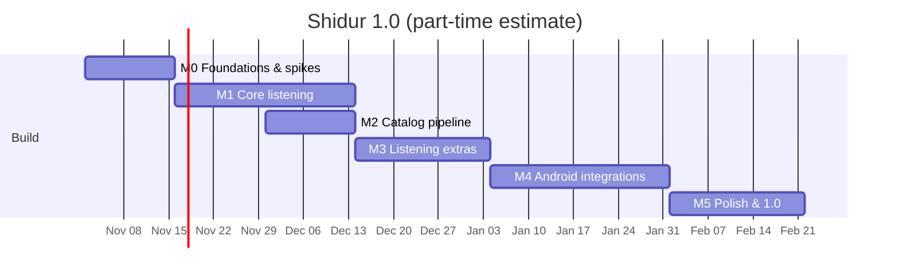

# SPEC-06 · Roadmap, Risks & Open Questions

| | |
|---|---|
| **Status** | Draft v0.1 — for review |
| **Date** | 2026-10-26 |
| **Related** | [Overview](SPEC.md) · [01 Product](SPEC-01-product.md) · [03 Architecture](SPEC-03-architecture.md) · [04 Catalog](SPEC-04-catalog.md) · [05 Quality & Release](SPEC-05-quality-release.md) |

The estimates assume **one developer working part-time (~10–15 h/week)**. Every milestone ends with a usable build published as a GitHub pre-release.

---

## 1. Milestones

| Milestone | Scope | Exit criteria | Est. |
|---|---|---|---|
| **M0 — Foundations & spikes** | Repo, license (GPL-3.0 + §7 permission), `build-logic` convention plugins, version catalog, module skeleton, CI (`ci.yml`), Spotless/Detekt/Lint, Roborazzi. `ShidurTheme` (dynamic/brand/pure black, Heebo, shapes, motion). Catalog models + `catalog-tools validate/build` + **10 flagship stations**. The **spikes in §2** | CI green; a debug APK plays a catalog station through the Media3 service with a media notification; spike reports written | 2 wk |
| **M1 — Core listening** | Catalog repository with bundled snapshot. Home / Browse / Favorites / Search. Mini and full player. `PlaybackService` with notification, lock screen, headset/BT controls, audio focus, becoming-noisy, reconnect + fallback, previous/next within the queue. Favorites (reorder), recents, settings (theme, pure black, dynamic color, language), first-run, Hebrew/English with RTL | F-01–F-05, F-17 (core), F-20 done → **`v0.1.0-alpha`** | 4 wk |
| **M2 — Catalog pipeline** *(can overlap M1)* | Full seed list (~45–50 stations), logo pipeline, `catalog-health` + issues, `catalog-publish` (Pages + jsDelivr), `radio-browser-sync`, status page, in-app remote sync, *Report a problem* / *Suggest a station* | F-18, F-19 (R1–R2); G2 being measured; a catalog-only change reaches the app without a release | 2 wk |
| **M3 — Listening extras** | Now playing (ICY/ID3 + HTTP adapters) and song actions; schedule adapters + UI; sleep timer; data saver; custom stations; share links + landing pages | F-06, F-07, F-11, F-12, F-13, F-15 → **`v0.5.0-beta`** | 3 wk |
| **M4 — Android integrations** | Android Auto (browse tree, search, `content://` artwork); widget; playback resumption; Bluetooth/headphones auto-resume; Wear OS verification; Google Cast | F-08, F-09, F-10, F-14, F-16; manual test plans pass → **`v0.8.0-beta`** | 4 wk |
| **M5 — Polish & 1.0** | Expressive motion (shared elements, predictive back, morphs); adaptive layouts (rail, supporting pane, tabletop); accessibility audit; full screenshot matrix; baseline profiles; ACRA; About/licenses; privacy & takedown pages; README/CONTRIBUTING; signing-key ceremony; **Android developer verification registration** (Full distribution, [SPEC-03 §14.1](SPEC-03-architecture.md#141-android-developer-verification-applies-to-github-distributed-apks)); release workflow | All P0 acceptance criteria and NFRs met → **`v1.0.0`** on GitHub Releases | 3 wk |

**Total: about 18 weeks part-time.** M2 overlaps M1, so the calendar is shorter than the sum.

**Proposed cut line**, needs maintainer approval (Q-08): if the schedule slips, **Google Cast (F-10)** and **Bluetooth auto-resume (F-14a)** move to 1.1. Neither blocks other features. The permission-free playback-resumption path (F-05 R8) still covers most car and headset cases.

### Post-1.0

| Release | Candidates |
|---|---|
| **1.1** | Catalog signing (Ed25519); Google Play preparation (closed test with ≥ 12 testers × 14 days, store listing, Android Auto review, Data safety); alarm clock; Quick Settings tile |
| **1.2** | Favorites import/export; per-device auto-resume station; *Discover more* via Radio Browser |
| **1.3+** | Standalone Wear OS app; time-shift (pause/rewind); Arabic and Russian UI (Weblate); Android Automotive OS build |

## 2. Technical spikes (M0, time-boxed)

| ID | Question | Method | Decides |
|---|---|---|---|
| **S-1 Metadata** | Which flagship streams carry ICY/ID3 now-playing data, and in what charset? | Use `catalog-tools probe` (or `curl -H "Icy-MetaData: 1"` / `ffprobe`) on ~15 flagship streams; log headers and 10 min of `StreamTitle` | Per-station `nowPlaying` declarations; how prominent the F-06 UI should be |
| **S-2 Cast** | Can the Default Media Receiver play Israeli MP3/AAC+/HLS streams over HTTPS, and does mixed-content blocking stop HTTP streams (no official doc says either way)? | Prototype with Media3 1.11's hybrid `CastPlayer` against 5 HTTP and 5 HTTPS streams (including HLS CORS) on a Chromecast/Nest | `castCompatible` rules; how prominent the per-station *can't cast* explanations are |
| **S-3 Bluetooth auto-start** | Do **Companion Device Manager** presence events (`onDeviceAppeared` / `onDevicePresenceEvent`) fire reliably when a **Bluetooth Classic** car kit or headset connects, and can playback start from them? Plain Bluetooth broadcasts **can't** start a foreground service from the background (verified) | Minimal prototype on Pixel (Android 16) and Samsung (One UI, Android 15/16) with a real car kit or BT speaker; measure success rate and latency; also test the "battery unrestricted" fallback | F-14a design ([SPEC-03 §9](SPEC-03-architecture.md#9-auto-resume-bluetooth--headphones)) |
| **S-4 Expressive APIs** | Exact shapes of the still-experimental M3 Expressive APIs in 1.5.0-beta (`ButtonGroup` was being restructured as late as alpha25) | Sample screen: `ButtonGroup`, `LoadingIndicator`, `HorizontalFloatingToolbar`, `ShortNavigationBar`, `WideNavigationRail`, `FloatingActionButtonMenu`, `MaterialShapes` morph | Material3 version pin; wrapper APIs in `:core:designsystem` |
| **S-5 App Links on github.io** | Confirm verification for our package. Research confirmed the mechanism: a user-site repo with `_config.yml` → `include: [".well-known"]` | Publish `assetlinks.json` and test with `adb shell pm verify-app-links` | F-15 link scheme ([SPEC-03 §11](SPEC-03-architecture.md#11-deep-links--sharing)) |
| **S-6 Android Auto** | Does the browse tree with `content://` artwork, grids, and search work on the DHU? | `MediaLibraryService` skeleton + DHU | F-08 structure |

## 3. Risks

Likelihood (L) and impact (I) are rated H / M / L.

| ID | Risk | L | I | Mitigation |
|---|---|---|---|---|
| R-01 | **Stream URLs change or break often** (CDN moves, mount renames) | H | H | Multiple URLs per station with stable redirectors preferred; 6-hourly health checks with auto-issues; Radio Browser drift detection; remote catalog updates without an app release; in-app fallback; one-tap *Report a problem* |
| R-02 | **Geo-blocking**, and health checks running from non-Israeli runners | M | M | `geo` flag per station (403 → unknown); optional self-hosted runner in Israel; user reports |
| R-03 | **A broadcaster objects** (logo, link) | M | M | Link-only playback; *unofficial* disclaimer; takedown within 7 days; remote `disabled` flag |
| R-04 | **Google Play rejection** (IP/impersonation, Android Auto quality) | M | M | Neutral branding, disclaimers, takedown policy, adherence to car quality guidelines. GitHub distribution is unaffected |
| R-05 | **Now-playing and schedule data unavailable or fragile** | H | L | P1 best effort; ICY auto-detection; adapters isolated per broadcaster; the UI hides missing data silently |
| R-06 | **Cast can't play HTTP-only streams** | H | M | `castCompatible` capability; HTTPS alternatives where available; per-station explanation in the UI (S-2) |
| R-07 | **Background-start limits** block Bluetooth auto-start (plain BT broadcasts can't start playback on Android 12+; OEM battery managers) | M | M | Companion Device Manager presence path (a sanctioned exemption); playback resumption as the baseline; feature off by default; battery-optimization guidance; S-3 |
| R-08 | **M3 Expressive API churn** (experimental APIs) | M | L | All usage wrapped in `:core:designsystem`; pinned versions; deliberate upgrades with screenshot diffs |
| R-09 | **Android developer verification.** Enforced since 2026-09-30 in 4 countries; global rollout to "all apps on certified devices" from 2027, with no Israel date published. Unregistered sideloaded APKs would need the high-friction "advanced flow" | H | H | Register Full distribution (one-time US $25 + ID; package + key fingerprint) during M5, before 1.0. Keep one signing key for GitHub and Play. Re-check the timeline at every release ([SPEC-03 §14.1](SPEC-03-architecture.md#141-android-developer-verification-applies-to-github-distributed-apks)) |
| R-10 | **Solo-maintainer bus factor** | M | H | Heavy automation; documented runbooks; `CONTRIBUTING`; recruit a co-maintainer for the catalog; CC0 catalog and GPL code allow forks |
| R-11 | **Scheduled workflows auto-disabled** after 60 days without repo activity | M | M | `keepalive` workflow; status page shows staleness; the app tolerates a stale catalog indefinitely |
| R-12 | **Hebrew metadata mojibake** (Windows-1255 vs UTF-8) | M | L | Charset detection plus a per-station override; fixture-based tests |
| R-13 | **GPL vs. proprietary Cast SDK** licensing ambiguity | L | M | GPL §7 additional permission; Cast isolated so a `foss` flavor stays possible |
| R-14 | **Scope is large for v1** (16 features including Auto, Cast, Wear, widget) | H | M | Milestones with shippable pre-releases; P1 items best-effort; the cut line in §1 |
| R-15 | **Streams move behind tokens or apps only** | L | H | Prefer official public URLs; remove stations without a public stream rather than reverse-engineer tokens |
| R-16 | **Bot protection** (e.g. Incapsula on glz.co.il) blocks schedule scraping | H | L | Best effort behind a feature flag; disable the adapter; never circumvent protections aggressively |

## 4. Open questions for the maintainer

| ID | Question | Default if unanswered |
|---|---|---|
| Q-01 | GitHub owner (user or org)? It sets the package name `io.github.<owner>.shidur` and the Pages URLs | Personal GitHub account |
| Q-02 | Contact email for crash reports and takedown requests? | A dedicated alias, e.g. `shidur.app@…` |
| Q-03 | GPL-3.0-**only** or GPL-3.0-**or-later**? | `-or-later` |
| Q-04 | Include all ~9 100FM digital channels at 1.0, or a curated subset? | All, inside the *Digital* collection |
| Q-05 | Include small regional and student stations that still need URL confirmation? | Only those verified by M2 |
| Q-06 | Run a self-hosted health-check runner in Israel (e.g. a Raspberry Pi)? | No; revisit if geo-blocking shows up |
| Q-07 | Should a shared link auto-play the station? | No: open paused and let the user tap Play |
| Q-08 | Approve the cut line (Cast and BT auto-resume → 1.1 if late)? | Yes |
| Q-09 | Which test devices are available (Pixel, Samsung, Wear OS watch, Chromecast/Nest, car with Android Auto)? | Emulators + DHU, plus whatever is available |
| Q-10 | App icon: design it yourself, use a community design, or have it generated from the spec's description? | Spec description ([SPEC-02 §2.8](SPEC-02-design.md#28-app-icon--splash)) |
| Q-11 | Are you OK with the one-time **US $25 + ID** Android developer verification (Full distribution) before 1.0? Without it, public sideloading will need Android's high-friction "advanced flow" once 2027 enforcement reaches Israel | Yes, register during M5 |
